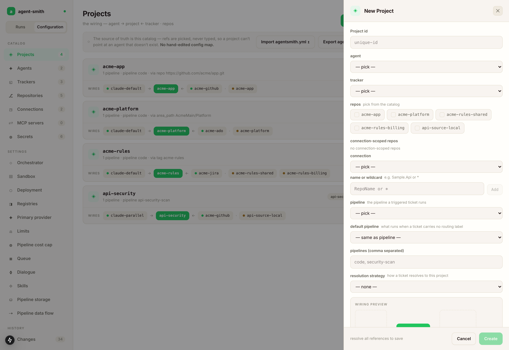
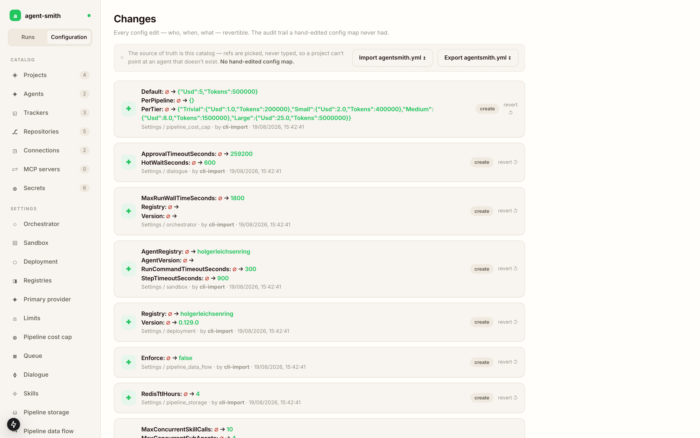

# The Config studio

The dashboard has two halves. The **Runs** side is where you watch work happen. The **Configuration** side is where you decide what work is possible. Toggle between them at the top of the left rail, or go straight to `/config`.

The rail is split the same way the configuration is: a **catalog** of things that exist, then the global **settings** that apply to all of them, then the change history. Counts next to each catalog tell you how many entries you have, which is a surprisingly good smoke test after an import. Every list and every picker is sorted alphabetically, ignoring case, so the entry you're looking for is where you expect it and not wherever the database happened to return it.

## The eight catalogs

| Catalog | What lives in it |
|---|---|
| Agents | LLM providers, the models each one may call, and which model each activity uses |
| Trackers | ticket sources, their workflow states, and their trigger behavior |
| Connections | repo discovery scopes, an org or project plus its auth, so you don't list 40 repos by hand |
| Repositories | individual repos the pipelines clone and push to, and what each connection discovered |
| Projects | the wiring: one agent, one tracker, a set of repos, templates, design sources, and how tickets route here |
| MCP servers | external MCP tool servers |
| Design sources | design tools a project reads designs from, with the token picked by secret name (Figma today) |
| Secrets | the env var *names* your config refers to, with values staying in the runtime environment |

Secrets deserve the emphasis. The studio stores a secret's name, the environment variable it is read from, and the fact that something references it. The actual token lives in your environment or your k8s Secret, and it never enters the database or an export. A secret something still references can't be deleted, and that includes a design source naming it.

### Which variable a secret reads

A secret you create in the studio reads the environment variable of exactly its name, case included: a secret `GITHUB_TOKEN` reads `GITHUB_TOKEN`, and a secret `github_token` reads a variable called `github_token`. So name it after the variable. A secret that came in through **Import agentsmith.yml** keeps the reference its file gave it, so `github_token: ${GITHUB_TOKEN}` reads `GITHUB_TOKEN`. An entry of the same name in the `secrets:` block of the server's own `agentsmith.yml` wins over both, on every load ([what a server reads from the file](index.md#what-a-server-reads-from-the-file)).

An agent's key secret works differently. The agent reads the environment variable the secret's name spells, directly, whatever the secret maps to. Name that secret after the variable in every case, such as `AZURE_OPENAI_API_KEY`. The fallbacks when that variable is empty are on [AI providers](../connect-your-stuff/ai-providers.md#api-keys).

## Adding something

Every catalog has a **New** button in the top right, and every entry has an edit on its card. Both open the same drawer.

Look at what the drawer does with references. `agent`, `tracker`, `connection` and the auth secret of a tracker or connection are dropdowns that list what you actually have. Repos are picked from the repo catalog or from a connection's discovered repos. Every reference is picked from the catalog. A hand edited config file lets you point a project at an agent you renamed last week, and you find out at 2am; picking from a list is how that stops being possible. For a project, the line at the bottom of the drawer names what is still unresolved, and **Create** stays disabled until every reference resolves.

The fields themselves come from the backend. Pick `type: github` on a tracker and you get Repository URL. Pick `azure_devops` and you get organization and project instead. That list of types is served from the same registry the runtime resolves against, so everything you can pick is something the server can actually construct. The auth secret is one of those fields: the type declares it a secret, so it appears once, marked required, as a pick from the Secrets catalog.

Before you save, the drawer shows what the server would report about the draft, under "what the server would report — before you save". A required field that is still empty blocks the save, and the footer names that field with the server's own reason; on a tracker it also names the tab the field sits on.

### Test before you save

The tracker and connection drawers have a **Test** button. It checks the unsaved draft against its host and saves nothing. The answer is a list of steps, each with a tick or a cross, and it stops at the first one that fails:

1. secret: the picked secret has a value on the server (named, never shown);
2. host: the first call gets an HTTP answer, so DNS, connection and TLS failures land here;
3. identity: the token signs in (a 401 or 403 lands here);
4. scope: the group, org, owner, Azure DevOps project, Jira project or repository is visible to that identity;
5. what's there: the repos discovery would find (a connection) or the open tickets (a tracker). A tracker that can't count says so, and a count that stops after one page says "at least".

Each step has ten seconds, the whole test thirty. Change the draft and the old answer disappears, because it was the answer for a different draft. Testing needs the `config.write` and `diagnostics.probe` permissions.

## Names are case-insensitive

`TodoList`, `todolist` and `TODOLIST` are one name everywhere a configured name is looked up: a project's `agent:`, a repo ref, a template target, a CLI `--project`. That's convenient until two entries of one catalog differ only in case, because then both spell the same entity. So the studio refuses to store a name whose differently cased twin is already there, and the refusal names both spellings. An import carrying such a pair is refused whole, and a configuration that already holds one reports it as a startup finding. The way out of an existing pair is export, keep one spelling, import with `--force`.

## Projects

A project card shows its facts as separate marks: the default pipeline (`default · code`, or `no default pipeline`), the resolution rule if there is one, the repository count, `built after <project>` when it has [templates](templates.md), and, only when something is wrong, a count of unfinished templates or of unresolved references. Those last two are different problems with different fixes, so the card keeps them apart: an unresolved reference names a catalog entry that doesn't exist, an unfinished template is one nobody finished filling in.

Click the card's row and it expands into the wiring graph, five columns from left to right: agent and tracker, the project, its repositories, the contexts those repositories hold, and what each context is built after. A context belongs to a repository and a template belongs to a context, which is why they get their own columns. Long names are shortened, and hovering one shows it in full. Colour is kept for what is wrong. It catches the class of mistake the drawer can't: the wiring that resolves fine and is still wrong, like the staging tracker pointed at the production repo, every reference valid, the shape visibly not what you meant.

**Edit** opens the drawer. Next to it sits **Initialize**, which runs `init-project` for the project with no ticket, an **Auto-accept PRs** toggle (on by default) that merges the pull requests the initialization opens where the branch policy allows it, and a **Refresh principles** toggle (off by default) that recomposes an existing `principles.md` from the catalog (core, language delta and framework overlays) and keeps its Project Specifics section. Both apply to the run they start and to nothing else, and neither affects the other. The button reads the project's live init run from the server, so it survives navigating away and back: while one exists it shows "Waiting for a slot — view run", "Initializing — view run" or "Cancelling — view run", and clicking it opens that run. A project has at most one live init, and a second start is refused until the first has finished.

Whether each repository is already bootstrapped is shown under **System → Config file reads**, in **Resolved configuration**: pick the project and every repository carries `initialised`, `not initialised` with the missing files listed, or why the host couldn't be read. It's read live from the repository's default branch when you open the panel. [Onboarding](../reference/setup/onboarding.md) has the rest.

### The project drawer

The project drawer has six tabs. A tab that needs attention carries a mark.

**identity**. The project's name, and its agent and tracker, both picked from the catalogs. Once the Design sources catalog holds an entry, a **design sources** picker appears here too; see [Design sources](design-sources.md).

**repos**. Repos from the repository catalog, and repos from a connection. Pick a connection and the picker lists what discovery found there, with each repo's default branch. Above the list sits the connection's discovery status: the last successful discovery with its time and repo count, the last failed attempt with its reason (a failure never hides the last success), and **Refresh now**. A connection with three hundred repos doesn't mean three hundred chips: there's a filter box, a count of how many matched out of how many were discovered, and a capped list with "show more". The filter box doubles as the wildcard box. Type `TodoList.*` and it offers to add the rule `acme/TodoList.*` with the number of repos it matches right now; every discovered repo a rule already covers shows as covered instead of offering a second, redundant pick. With a wildcard in the filter, "select all" proposes that one rule rather than ticking every match individually. The wildcard is `*`; see [Repos: multi-repo](../connect-your-stuff/repos-multi.md) for how rules and exclusions resolve.

**pipeline**. One control, the project's default pipeline, picked from the pipelines the product offers. Next to it, read only, the tracker's label map, because that's what actually decides what an incoming ticket runs. The panel says which of three cases you're in: the tracker maps labels, and a ticket matching none of them isn't routed to this project at all; or the tracker maps no label and declares a default pipeline, and every ticket runs that; or it declares neither, and every ticket runs `code` while the panel tells you to set a default pipeline on the tracker. A stored configuration may still carry a retired pipeline name; it loads, labelled as retired ("it no longer runs; pick a current one to replace it"), and it isn't offered again.

**templates**. What each context of this project is built after. See [Project templates](templates.md).

**routing**. The resolution strategy (`tag`, `area_path`, `repo`, `to_address`) and its value, which is how a ticket finds this project. [Project resolution](../reference/configuration/project-resolution.md) has what each strategy compares.

**sandbox**. Per-project overrides for the sandbox. Every field is an override: leave it empty and the project inherits the value the placeholder names, and the help text says where that value comes from (a Settings value, the `SANDBOX_HOLD_SECONDS` environment variable, a built-in default, or "detected per run from the repository"). The fields are toolchain image, step timeout (seconds), run_command timeout (seconds), agent registry, agent version, sandbox hold (seconds), cpu & memory (all four quantities or none), per-language images, secret environment variables and mounted secret files. The secret fields inherit nothing, because there's no process-wide secrets block to inherit from, and they hold Kubernetes Secret names and keys, never values. An override applies to the next run of the project; the sandbox hold applies to the next turn of a design conversation. What each of these does at runtime is on [Sandbox architecture](../reference/concepts/sandbox-architecture.md).

The cpu & memory group can't name one inherited number, because what a run gets depends on its pipeline, and a project's runs pick their pipeline per run (a ticket's labels, a trigger's default, the CLI). So it states both answers side by side: what a run that changes code gets (the process-wide sandbox default, or what the repository's context file names, clamped to the operator ceiling), and the fixed light profile every pipeline that changes no code is held to. Switching the group on seeds all four quantities from the code-run answer.

## Trackers

A tracker owns the workflow for every project routed to it, and its drawer has five tabs, one per kind of decision a field makes:

- **Connection**: the type, where the board lives (URL, organization, project, project path or key, Jira's account email and REST path overrides), the auth secret, and the **Test** button.
- **Intake**: which tickets are picked up. Trigger statuses, open states, extra ticket fields to fetch, the comment on a ticket no project matched, and polling.
- **Outcomes**: where a ticket moves when a run ends. Done, failed, needs-clarification and not-implementable status sit in one table under "When a run ends, move the ticket to", and when two of them name the same status the tab says the board can't tell those outcomes apart. The Jira close transition name and the lifecycle status names live here too.
- **Routing**: the label map ("Pipeline by label"), the "Default pipeline" for a ticket no label matched, and the label names the framework writes. Both pipeline fields are pick lists over the pipelines a ticket can actually be routed to, so you can't type a pipeline that doesn't exist.
- **Filing**: the work-item or issue type a ticket Agent Smith files is created as (Azure DevOps and Jira).

Three of those maps change what Agent Smith writes onto your board:

- **Label names** renames the labels the framework writes (`agent-smith:done` and friends, plus the approved-set stamp) for boards with their own vocabulary.
- **Lifecycle status names** (Jira) moves issues through native workflow statuses instead of carrying the lifecycle only as labels.
- **Work item kind by filing role** (Azure DevOps and Jira) sets which work-item or issue type a ticket Agent Smith files is created as.

The tracker pages under [Connect your stuff](../connect-your-stuff/tracker-jira.md) spell out the keys. One refusal worth knowing up front: a label the framework writes may not be the same word as one of your routing words (a key of the label map, or a project's resolution value). The studio refuses that save and names the word, because a ticket would otherwise route itself on the framework's own bookkeeping.

## Connections and discovered repos

A connection is a type, a scope (owner, group, or organization plus project), an optional host, and an auth secret. Every API call, clone, fetch and push uses the token, host and account of the connection or tracker it belongs to, so a second GitLab instance or a second Azure DevOps organization is just another entry with its own secret. The connection drawer has the same **Test** button as the tracker drawer.

The **Repositories** page lists the catalog entries and, below them, what each connection discovered, read only, with a "referenced by" mark wherever a project uses a repo. Each connection's section carries the same discovery status as the project drawer: last success with time and repo count, last failed attempt with its reason, and **Refresh now**. The status lives on the server, so every replica shows the same one.

## Agents

An agent declares the models it may call once, in a named catalog, and then says which of those entries each activity uses. The drawer follows that shape with four tabs: **Models**, **Activities**, **Provider** and **Tuning**.

**Models** lists one card per catalog entry: its name, the model id, the tier, which activities use it, and the price the server would charge for it (input, output and cache read per million tokens) with where that price comes from. **+ Add model** and a click on a card open the entry editor inside the same drawer:

- the model id, with a search over the bundled public price list. Ids your provider's API accepts as written are offered first (so an Anthropic agent sees the Anthropic id before the Bedrock and Vertex spellings), then by how well the id matches. It ranks and never filters, because an OpenAI-compatible endpoint may run any id;
- an Azure deployment name, when it differs from the model id;
- price and window: what the price list says, and a checkbox to override it;
- context window and max tokens;
- the tier: `strong`, `fast`, or none;
- the name activities pick it by;
- optionally a different provider or endpoint for this one entry.

An entry an activity still uses can't be removed; the editor names the activities to move first.

**Activities** gives every role the product routes a pick from the catalog: Coding (`primary`), Planning, Review & checks (`reasoning`), Project init (`contextGeneration`), Code map, Quick lookups (`scout`) and Summaries (`summarization`), each with a line on what it covers. Coding is required. Every other activity left unset follows Coding, and Code map follows Quick lookups when that one is set. Some activities carry a **needs strong** mark, because every later step builds on their answer. Point one of them at an entry tiered `fast` and the activity says so, the tab gets a mark, and the server reports it as an advisory finding. It's advice and nothing refuses it: the product never decides which model is strong, your tier does.

**Provider** holds the provider type, the key secret, endpoint, API version and network timeout. **Tuning** holds prompt caching, compaction and retry, which stay collapsed and absent until you add them, so an agent you never touched keeps a clean record instead of a wall of persisted defaults.

Every catalog model needs a price, and most already have one: the bundled public price list knows the hosted models by id, and the agent's pricing table only overrides it. A model the list doesn't know needs an override, and the studio refuses to save an agent with a catalog entry neither knows ("has no pricing entry — the bundled price list does not know it; add it to the agent's pricing table"). The Models tab warns about that before you press save. That's what keeps the dollar figure on every run honest. [Cost tracking](../reference/concepts/cost-tracking.md) has how a price is resolved.

A model id the provider doesn't recognise is caught at the first call: the run fails, and its summary names the role, the catalog entry and the id.

## Design sources

A design source is a design tool account a project can read from. Today that's Figma: the drawer has a vendor (`figma`), an auth secret picked from the Secrets catalog, and an optional display name. A project lists the design sources it may use on its identity tab, and from then on its runs and its design conversations can read a Figma link. [Design sources](design-sources.md) walks through the setup and what a read returns.

## Changes and revert

Every write lands in the change feed with the fields it touched, the old value, the new value, who did it, and when.

Each row has a revert, which is the part a mounted ConfigMap could never give you. Someone widened a cost cap three weeks ago, the run bills went up, and now you can find that exact edit and undo it, instead of reconstructing what the file used to say from a git history that may never have existed.

## What the studio does not carry

- `pipeline_triggers:`, the global label to pipeline map. It's stored in the database and the server serves it, but there's no catalog screen for it. To change it: export, edit the block, import with `--force`.
- `dialogue.dashboard_url`, the dashboard address a question comment links to. Set it through import.

Everything else you'd want to change day to day is here or under [Settings](settings.md).
