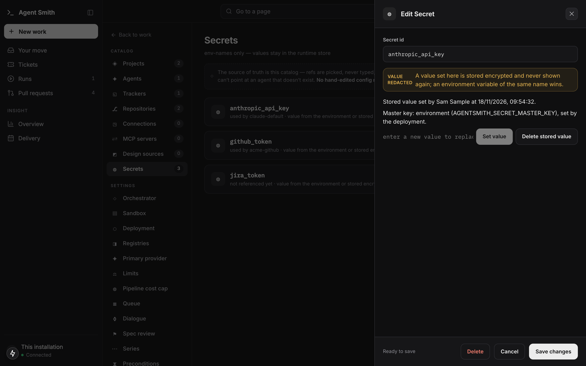

# Secrets

<p class="cb-lead">A secret in the catalog is a name. Its value comes from the server's environment, or from a value an admin stored in the Config studio, encrypted under a master key that is never in the database. An environment variable always wins.</p>

<figure class="cb-shot" markdown>

<figcaption>Config studio > Secrets > a secret. A stored value is never shown again; the drawer says who set it, when, and where the master key comes from.</figcaption>
</figure>

## What the catalog holds

The **Secrets** catalog holds each secret's name, the environment variable it reads, and what references it. Trackers, repositories, connections, agents and design sources pick their secret from this list, so a reference can't point at a secret that doesn't exist. A secret something still references can't be deleted. Values never appear in an export.

## Where a value comes from

For every credential the server needs, the same order applies:

1. **The environment variable**, when it is set and not empty.
2. **The stored value** of the catalog secret of that name, set in the studio.

So a deployment that already passes every token as an environment variable keeps working unchanged, and an installation without access to its runtime environment can set values in the studio instead. The rule covers tracker and repository tokens, agent keys, the webhook secrets (`GITHUB_WEBHOOK_SECRET`, `GITLAB_WEBHOOK_TOKEN`, `AZDO_WEBHOOK_SECRET`) and the Slack and Teams credentials (`SLACK_BOT_TOKEN`, `SLACK_SIGNING_SECRET`, `TEAMS_APP_PASSWORD`). Those are read on each use, so a stored value reaches them without a restart.

What stays environment-only is what the server needs before it can open the database: the persistence settings, the master key itself, and the sign-in settings.

### Which variable a secret reads

A secret you create in the studio reads the environment variable of exactly its name, case included: a secret `GITHUB_TOKEN` reads `GITHUB_TOKEN`, and a secret `github_token` reads a variable called `github_token`. So name it after the variable. A secret that came in through **Import agentsmith.yml** keeps the reference its file gave it, so `github_token: ${GITHUB_TOKEN}` reads `GITHUB_TOKEN`. An entry of the same name in the `secrets:` block of the server's own `agentsmith.yml` wins over both, on every load ([what a server reads from the file](index.md#what-a-server-reads-from-the-file)).

An agent's key secret is looked up by name, ignoring case: the agent reads the environment variable its `api_key_secret` spells, and if that is empty, the catalog secret of that name with its stored value. `api_key_secret: ANTHROPIC_API_KEY` finds a secret named `anthropic_api_key`. The fallback variables per provider are on [AI providers](../connect-your-stuff/ai-providers.md#api-keys).

## Storing a value

Open the secret, type the value into the password field and press **Set value**. Setting a value needs `secrets.write`. The value goes straight to the server and is written by a `secret` run with a run id, so the change is attributed like any other.

Each value is encrypted with a key of its own (AES-256-GCM with a random nonce, so two equal values never store equal bytes), and that key is wrapped by the **master key**. The master key is never in the database. Without one the field says so and stores nothing.

A stored value is never shown again: not by the studio, the API or the [admin assistant](../how-it-works/admin-assistant.md). The drawer shows who set it and when, and **Delete stored value** removes it. Setting it again rotates it.

### The master key

Give the server 32 random bytes, base64-encoded, in one of two ways:

```bash
openssl rand -base64 32       # make a key
```

| Variable | What it holds |
|---|---|
| `AGENTSMITH_SECRET_MASTER_KEY` | the base64 key itself |
| `AGENTSMITH_SECRET_MASTER_KEY_FILE` | a path to a file holding it, for a mounted k8s Secret |

In docker-compose, put it in the `.env` file the server reads. On Kubernetes, add it to the server's Secret.

!!! warning "Keep the master key"
    The master key is the only way to open the stored values. Lose it and every stored value reads as empty: back it up the way you back up the database.

### Rotating the master key

Move the old key to `AGENTSMITH_SECRET_MASTER_KEY_PREVIOUS` (or `AGENTSMITH_SECRET_MASTER_KEY_PREVIOUS_FILE`), set the new one, restart, and press **Re-wrap with the current master key** in any secret drawer. Every stored value is then wrapped with the new key and the previous one can go. Identical current and previous keys are refused.

### When a value can't be opened

A stored value the server can't open (the master key that wrapped it is gone, the vault can't be reached, or the row was altered) resolves to nothing and is reported on every load, naming the secret and its key. For the webhook secrets and `SLACK_SIGNING_SECRET` that state refuses every delivery, and each refusal is logged with the secret and the reason, until the value is set again or the environment variable is. A secret with no value at all, in the environment or stored, leaves verification off, as before.

### Orphaned values

A stored value whose catalog secret was deleted is listed in every secret drawer, with who set it and when, and a **Delete**. The [admin assistant](../how-it-works/admin-assistant.md) can draft the same cleanup. Applying that draft needs `secrets.write` besides `admin.assistant`; without it Apply is refused and names the permission.

## Keeping the master key in Azure Key Vault

The deployment can hold the master key wrapped instead of raw, so a leaked environment or k8s Secret is useless without access to the vault. Create an RSA key (2048 bits or more) in Key Vault, give the server's identity the **Key Vault Crypto Service Encryption User** role on it, and wrap a fresh 32-byte key with the key's public half:

```bash
az keyvault key download --vault-name <vault> --name <key> --file key.pub.pem
openssl rand 32 | openssl pkeyutl -encrypt -pubin -inkey key.pub.pem \
  -pkeyopt rsa_padding_mode:oaep -pkeyopt rsa_oaep_md:sha256 -pkeyopt rsa_mgf1_md:sha256 | base64
```

Set the output as `AGENTSMITH_SECRET_MASTER_KEY_WRAPPED` (or mount it and point `AGENTSMITH_SECRET_MASTER_KEY_WRAPPED_FILE` at it), and set `AGENTSMITH_SECRET_KEY_VAULT_KEY` to the key's versioned identifier, `https://<vault>.vault.azure.net/keys/<key>/<version>`. The server asks the vault to unwrap the key once, when it first needs it. It signs in as itself: workload identity, a managed identity (`AZURE_CLIENT_ID` picks a user-assigned one) or a service principal from the environment, never someone's `az login`. If the vault doesn't answer, stored values read as empty and the drawer says why.

To move an existing raw key into the vault, wrap that same key (`echo <base64 key> | base64 -d | openssl pkeyutl …`) and swap the variable. Stored values keep opening without a re-wrap. For a new key, keep the old one as `AGENTSMITH_SECRET_MASTER_KEY_PREVIOUS` or `AGENTSMITH_SECRET_MASTER_KEY_WRAPPED_PREVIOUS` and press **Re-wrap**. A previous wrapped key is unwrapped with `AGENTSMITH_SECRET_KEY_VAULT_KEY_PREVIOUS`, or with the current vault key when that variable is unset.

The key's source is part of the deployment and not a setting, because anyone who can write the database could otherwise point it at a key they hold. The secret drawer shows which source is in use.

## Next

- [The Config studio](config-studio.md): the rest of the catalog.
- [Admin assistant](../how-it-works/admin-assistant.md): reads secret presence, never values.
- [Access control](../reference/security/access-control.md): who holds `secrets.read` and `secrets.write`.
