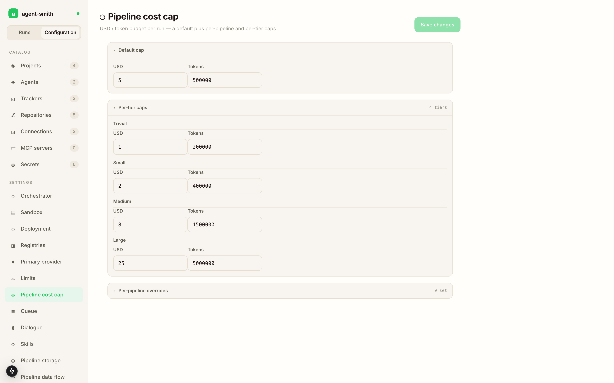

# Settings

Below the catalogs in the studio rail sit fourteen global settings groups. Each one is a typed form over a top level block of `agentsmith.yml`, and each one applies to every project unless a project overrides it.

They save the same way the catalogs do: one **Save changes**, a row in the change feed, and a live pickup by the running server, except where a field says it applies after a restart. A value the server would refuse at run time (a negative round count, a series cap above 26) is refused on save instead, and the reason shows under the Save button.

## What each group changes

### Orchestrator

`MaxRunWallTimeSeconds`, the ceiling on how long one run may take before it gets cancelled. It defaults to 1800, so a run that is still going after thirty minutes is stopped. Raise it for a codebase where a legitimate run genuinely takes longer, and lower it if you would rather find out early.

### Sandbox

The sandbox agent image (registry and version) plus two timeouts, `StepTimeoutSeconds` at 900 and `RunCommandTimeoutSeconds` at 300. The two are one rule: a `run_command` gets the command timeout when it asks for none, may ask for more, and is killed at the step cap. So the step cap is the ceiling a command may request, and raising it raises what a command may ask for; the command timeout can't be set above it. A repo whose test suite runs longer than five minutes needs the command timeout raised, and the symptom when you haven't is a command that reports it timed out at the same second every time.

Leave the agent version empty and the sandbox agent tag is derived from the release the running server is, so the two can't drift apart by being forgotten. Set it only to pin a different published tag on purpose (an air-gapped mirror carrying one release, say); a pin is reported as an advisory finding, never refused.

The image pin and the two timeouts are read from an instance built at startup, so they need the server restarted; each of those fields says so. The rest of the group applies without one:

- `MaxConcurrentSandboxes`: the Docker capacity probe reads it each time it decides whether a run fits. The field is optional (the same key is `max_concurrent_sandboxes` in `agentsmith.yml`), and left empty it falls back to the `SANDBOX_MAX_CONCURRENT` environment variable, then to the built-in default of 2. `0` means unbounded. It bounds the **Docker** backend only: a Kubernetes installation bounds sandboxes through its namespace `ResourceQuota` and the in-process backend is unbounded. The full story is on the [capacity page](../reference/operations/capacity.md#where-the-concurrent-sandbox-bound-is-set).
- Sandbox hold (seconds): how long a design conversation keeps the source sandboxes it opened after a turn, so the next question doesn't pay for the clone again. Empty falls back to `SANDBOX_HOLD_SECONDS`, then 180; `0` holds nothing. A project can override it on its own sandbox tab.
- **Trusted image registries**: where a context's `stack.image` may come from (`allowed_registries` and `allow_docker_hub_library` in `agentsmith.yml`). Each entry is a prefix of the image reference as Docker reads it, so an image with no registry host counts as `docker.io`: `sbtscala/` and `docker.io/sbtscala/` are the same entry, and `docker.io/` alone trusts all of Docker Hub. With no entry the built-in default applies (`mcr.microsoft.com/` and `ghcr.io/`), and adding the first entry starts from those two as visible, removable rows, so naming one registry doesn't silently drop the others. A select decides the Docker Hub official images (`node:20-bookworm`): follow the registry list (trusted while you name no registry, refused once you do), trust, or refuse. Below it, **In force now** shows the boundary the next decision is judged against, as the server reads it, and says when the form has unsaved changes. A save applies to the next image decision. The boundary judges the `stack.image` a context declares, and a refused one falls back to the language default. An image you name yourself in a project's sandbox tab is your choice and passes as written, and so do the built-in fallbacks.

Every one of these except `MaxConcurrentSandboxes` and the registry boundary can be overridden per project in the project drawer's sandbox tab (see [The Config studio](config-studio.md#the-project-drawer)). Image pull secrets and what the hold does to capacity live with the rest of the sandbox model on [Sandbox architecture](../reference/concepts/sandbox-architecture.md), and the registry boundary from the cluster side on [Kubernetes](../host-it/kubernetes.md#which-registries-a-toolchain-image-may-come-from).

### Deployment

A single registry plus version for the sandbox agent image, used when the Sandbox group leaves its own unset. Left empty, the tag is derived from the running server's release, so there is nothing to bump on upgrade; set it only to pin a tag on purpose.

### Registries

Private package feeds the agent authenticates against inside the sandbox, so `dotnet restore` or `npm install` against your internal feed works without baking credentials into a toolchain image.

### Primary provider

The agent used when a project doesn't name one.

### Limits

The ceilings on one agentic loop: tool calls, tokens, sub agents, concurrent skill calls. These stop a confused loop from grinding, and they apply per skill rather than per run.

### Pipeline cost cap

The money one. A default cap in USD and tokens, four tier caps (trivial, small, medium, large) applied by the estimated size of the work, and optional per pipeline overrides. A run that hits its cap stops and says so. A tier you never edited keeps its built-in default ($1, $2, $8 and $25), and the form shows that value marked as the default; editing one stores only that tier. [Pipeline cost cap](../reference/configuration/pipeline-cost-cap.md) has the token halves and how a tier is picked.

### Queue

Consumer backpressure, and how often the queue retries against Redis.

### Dialogue

How long a run waits for you. `HotWaitSeconds` is the window it holds the sandbox open expecting a fast answer. `ApprovalTimeoutSeconds` is how long the question stays answerable before the run gives up. The defaults are ten minutes and three days.

The same block carries `dashboard_url`, your dashboard's address, so the ticket comment that asks a question links to the run's page. Without it the comment carries no link. The form has no field for it; set it through import.

### Spec review

Before the coding master builds a spec whose text isn't the one a person approved, fresh reviewers attack it and their cuts are applied. This group sizes that review:

- Rounds per spec, 4 by default. `0` turns the review off.
- Reviewers per round, 2: fresh reviewers attacking each spec in one round.
- Max concurrent reviewers, 2.
- Budget share (percent), 40: the share of the run's cost cap and wall clock the review may use. A spec the review didn't clear within it is left to the next attempt.

The block is `spec_review:` (`rounds`, `reviewers`, `max_concurrent`, `budget_share_percent`), and every run reads it fresh. A proposal in [Work it out](../how-it-works/work-it-out.md) goes through review rounds sized by the same block before you can approve it.

### Series

How big a ticket's series of specs may get, how much of it one attempt runs, and how far a chain of attempts may go on by itself:

- Max specs, 24: the most specs one ticket's series holds, between 1 and 26 (one member letter each).
- Specs per attempt, 8: the most specs one attempt runs. It can't exceed max specs, nor 18, the most one run's step guard holds.
- Seconds per spec, 0: the measured time of one whole spec block (build, review, verify, record). With a value, an attempt runs fewer specs when the blocks left don't fit the run's wall clock, keeping one block for the commit and PR. `0` means not measured, and specs per attempt alone decides. The server refuses a value where two blocks exceed the Orchestrator's run wall time.
- Budget (USD), 150: what one chain of attempts may spend before the next attempt is held for a person. `0` turns automatic continuation off, so no attempt starts by itself.
- Wall clock (hours of run time), 12: the summed run time of one chain before the next attempt is held. Time spent waiting between attempts doesn't count.
- Continue after a wall-time cancel, on: whether an attempt the wall clock cancelled after a finished spec goes on with the next attempt.

The block is `series:` (`max_specs`, `specs_per_attempt`, `seconds_per_spec`, `budget_usd`, `wall_clock_hours`, `continue_after_wall_time`), read fresh by every run.

### Skills

Where the skill catalog is resolved from. Every release ships with its catalog embedded, so there is nothing to pin here. It exists as an override for skills development and for air gapped mirrors.

### Pipeline data flow

Whether the data flow gate warns or enforces.

### Trace

Whether a run records its conversation (every prompt as sent, every answer, every tool result as the model received it), not only its numbers. Off by default, because a traced run's record grows fast. The `AGENTSMITH_TRACE` environment variable, when it is set, wins over this switch in both directions, so a deployment that sets it in its manifest keeps what the manifest says. See [Recording what the model was told](../connect-your-stuff/ai-providers.md#recording-what-the-model-was-told).

## What the settings rail leaves out

`persistence:` is absent on purpose. It's bootstrap only, read from the file before the server can talk to a database, so making it editable in a UI backed by that database would be a circle. Change it in `agentsmith.yml` and restart.

`auth:` and `tool_runner:` are bootstrap as well: the token authority is wired before the database is reachable, and the scanners' runner is built at start. Both stay in the server's own `agentsmith.yml`. An import doesn't store them and says so, as it does for every other key of the file it doesn't keep.

`secrets:` is absent because it has its own catalog. The studio holds names, and values stay in the environment.
