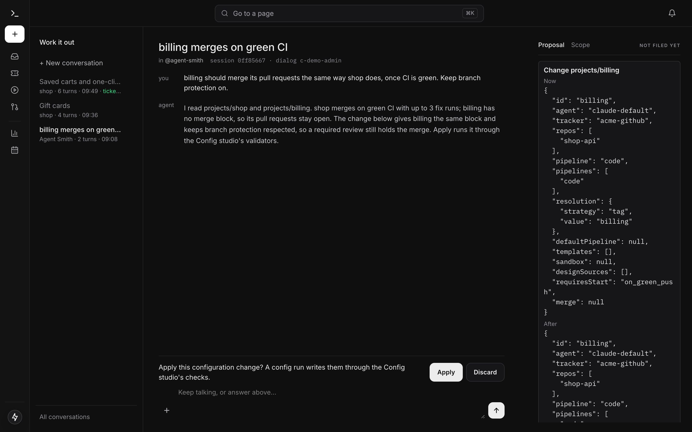

# Admin assistant

Admins get one more conversation in Work it out: <strong>Agent Smith</strong>. It answers questions about the installation itself (why a run stopped, where the money went, what the configuration says) and drafts configuration changes you apply with one click.

<figure class="cb-shot" markdown>

<figcaption>The assistant read both projects and drafted one change. The pane shows the project before and after; nothing changes until <strong>Apply</strong>.</figcaption>
</figure>

## Who can open it

The conversation runs on the installation, not on a project. It needs the `admin.assistant` permission, which only the `admin` role holds. Everyone else doesn't see it: its conversations and runs are hidden from them, and a direct link answers as if it didn't exist. In the conversation list it reads **Agent Smith**; its head line reads `in @agent-smith`. It opens from the dashboard only, not from Slack or Teams.

The assistant runs on the agent named in `dialogue.admin_agent` (Settings > **Dialogue**). Without one it refuses and names the key.

## What it can read

Its tools read the server's own records and nothing else:

- runs, their steps, decisions and how they ended
- LLM calls with their prompt ids, totals per role and model, cache reads and writes
- a run's events, filtered by type or step
- stored prompts, block by block
- tickets with their pull request records
- the effective configuration, and which secrets are present or missing
- health: startup findings, recent system events, the replica that answered

It cites the ids it read, so you can open the same run or call yourself. Every result is passed through the secret masker, and a secret's value is never readable: only whether it is set. List reads stop at `dialogue.admin_read_limit` (default 50) entries and a single result at `dialogue.admin_result_max_chars` (default 40000) characters.

Typical questions: *why did run 2026-11-18T04-20-11-d41a stop?*, *which role spent most on ticket 41?*, *which projects still merge by hand?*

## What it can change

Ask for a change and the assistant drafts it rather than doing it. A draft can create, update or delete any entry the [Config studio](../configure-it/config-studio.md) holds (agents, trackers, repositories, projects, MCP servers, secrets, connections, design sources and settings), so duplicating a project, moving a repository to another project or cleaning up unused entries are all drafts of those.

The pane shows each item as **Now** and **After**. **Apply** starts a `config` run with a run id that writes the items in order through the studio's own store and validators:

- Each write is attributed as *&lt;you&gt; via admin assistant (run &lt;id&gt;)* and shows in **Changes**, where it can be reverted like any studio edit.
- An item whose stored entity changed since the draft was made is refused, so you never apply over someone else's edit.
- The first refusal stops the run, and the items it already wrote are reverted in reverse order. The report names the item, its kind and id, and the store's reason.

The running server picks up the change without a restart.

### Secrets

The assistant can draft a catalog secret like any other entry, but it can't set a value: values are set in the secret drawer ([Secrets](../configure-it/secrets.md)). It can draft the deletion of a stored value whose catalog secret is gone. Applying a draft that deletes a stored value needs `secrets.write` as well; without it Apply is refused and names the permission. Stored values are deleted last, after every other check of the run passed.

## Settings

| Key | Default | What it changes |
|---|---|---|
| `dialogue.admin_agent` | none | the agent the assistant runs on; required |
| `dialogue.admin_read_limit` | 50 | entries one list read returns |
| `dialogue.admin_result_max_chars` | 40000 | characters one read returns |

## Next

- [Secrets](../configure-it/secrets.md): stored values and the master key.
- [Access control](../reference/security/access-control.md): roles and permissions.
- [Work it out](work-it-out.md): the page the conversation lives on.
