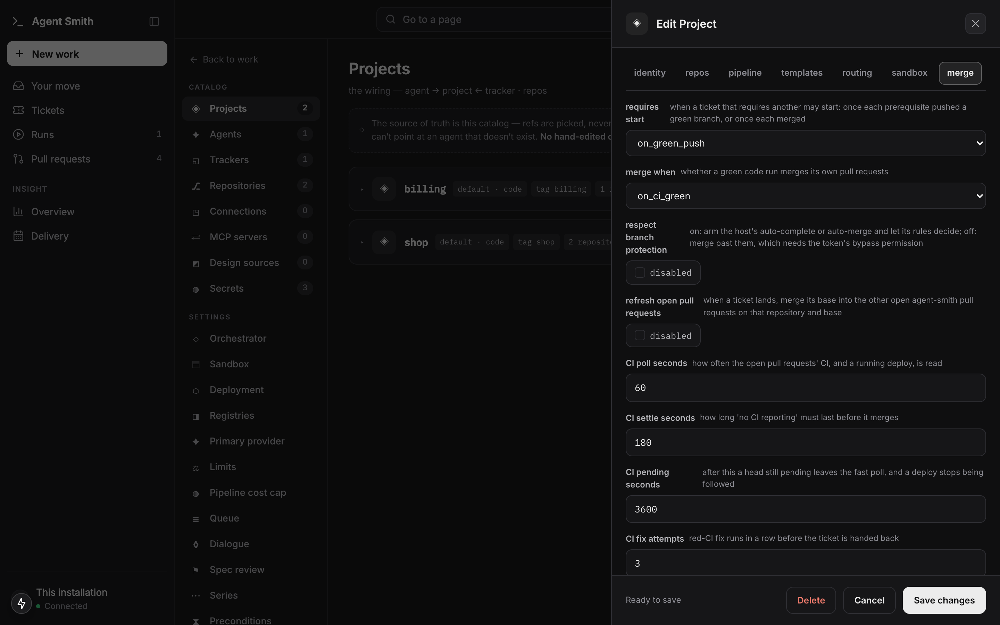

# CI loop and merge policy

<p class="cb-lead">A green run opens pull requests. Whether codeably also merges them, waits for your CI first, and sends a red check back to be fixed is set per project in its <code>merge</code> block.</p>

<figure class="cb-shot" markdown>

<figcaption>Config studio > Projects > Edit > <strong>merge</strong>. Everything on this page is set here, or in the project's <code>merge:</code> block.</figcaption>
</figure>

## When to merge

| `merge.when` | What happens after a green run |
|---|---|
| `manual` (default) | The pull requests stay open for a person. |
| `on_gate_green` | The run merges its own pull requests as its last step, once every spec passed verification. Later work fixes forward. |
| `on_ci_green` | Each pull request reads *waiting for CI*. Once CI is green on all of them, a `merge-green` run merges them. |

A red, partial or record-only run never merges, whatever the policy. Neither does a pull request with red CI.

## Branch protection

`respect_branch_protection` decides who has the last word:

- **Off (default):** the merge goes past branch policies, required reviews and required checks, which exist for people. The token needs the permission to bypass them: on Azure DevOps *Bypass policies when completing pull requests*; on GitHub repository admin with bypassing allowed, or the token's actor on the ruleset's bypass list. GitLab has no API bypass for required approvals or pipelines, so it merges when its merge checks allow.
- **On:** codeably arms the host's own mechanism (auto-complete on Azure DevOps, auto-merge on GitHub, merge when the pipeline succeeds on GitLab) and the host's rules decide.

Where the host requires an approval, `approval_auth` names the secret of a second identity that approves. GitHub never lets the author approve its own pull request, so a required review there needs one. A refusal leaves the pull request open and the run's result names the reason, the missing permission and the key to change.

## Reading CI

Every open pull request's CI is read with its record and shown on the ticket page: `none`, `pending`, `green` or `red`. One rule for every host: where checks are marked required, only those count; any failed check is red; otherwise anything running is pending; otherwise green.

For a red head, codeably stores which checks failed, with a bounded excerpt of the evidence (the host's summary and annotations, then the end of the log) and a link. GitHub check runs and statuses, Azure DevOps build policies and statuses, and GitLab head pipelines are all read. The token needs read access to checks and logs on GitHub, Build (read) on Azure DevOps and `read_api` on GitLab.

## The fix loop

With `on_ci_green`, a red CI on the head the green attempt pushed starts a **fix run**. Its task is the failed checks' evidence: names, excerpts, links. It fixes, verifies locally and pushes to the same pull request, never force-pushing, and the CI watch starts again. On the ticket page the run's cause reads `ci`.

The loop stops in two cases:

- `ci_fix_attempts` fix runs in a row (default 3) didn't turn CI green, or
- a fix run pushed nothing.

Then the next run hands the ticket back in its clarification status, with the evidence on the ticket. Your comment or approval starts the next attempt, and the count starts again.

## Keeping other pull requests current

With `refresh_open_pull_requests: true`, a landing merges its base into every other open codeably pull request on the same repository and base, in a `refresh-base` run, pushed without force. Collisions in the `state.done` index of `.agentsmith/contexts/*/context.yaml` are united; any other conflict leaves the branch alone and is said on the pull request. Closed, running, queued and waiting tickets are skipped.

## Branches after the merge

A merge codeably performs deletes its `agent-smith/` branch on Azure Repos, GitHub and GitLab. For merges a person makes, a `branch-cleanup` run per project deletes every `agent-smith/` branch whose pull request merged or closed and that hasn't moved since. Open branches, branches another pull request targets and branches without a pull request are kept. The interval is under **Branch cleanup** in [Settings](../configure-it/settings.md).

## The keys

```yaml
projects:
  shop:
    merge:
      when: on_ci_green               # manual | on_gate_green | on_ci_green
      respect_branch_protection: false
      refresh_open_pull_requests: false
      ci_poll_seconds: 60             # how often open pull requests' CI is read
      ci_settle_seconds: 180          # how long "no CI" must last before it counts as none
      ci_pending_seconds: 3600        # after this a pending head leaves the fast poll
      ci_fix_attempts: 3              # fix runs in a row before the ticket comes back
      ci_excerpt_chars: 4000          # evidence kept per failed check
      ci_failed_checks_read: 5        # failed checks whose logs are read
      approval_auth: github_approver  # optional: secret of the approving identity
```

Every key with its default is in the [agentsmith.yml reference](../reference/configuration/agentsmith-yml.md).

## Next

- [Stacked start](stacked-start.md): dependents don't wait for the merge.
- [Series run](series-run.md): many tickets, one conversation.
