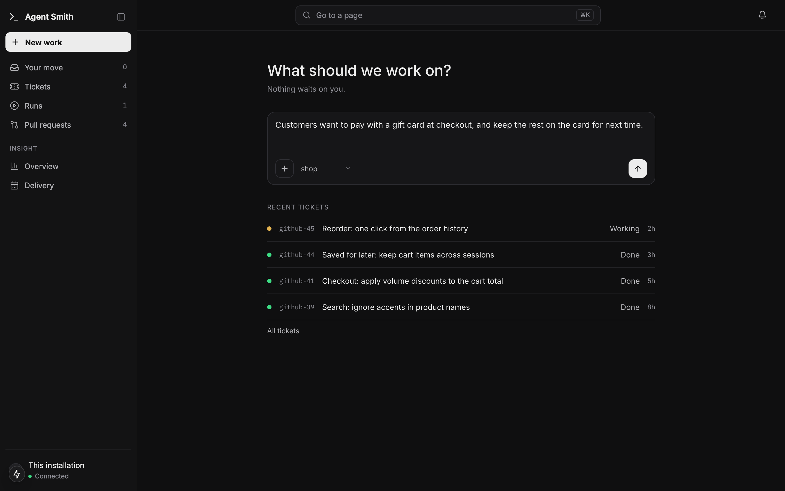
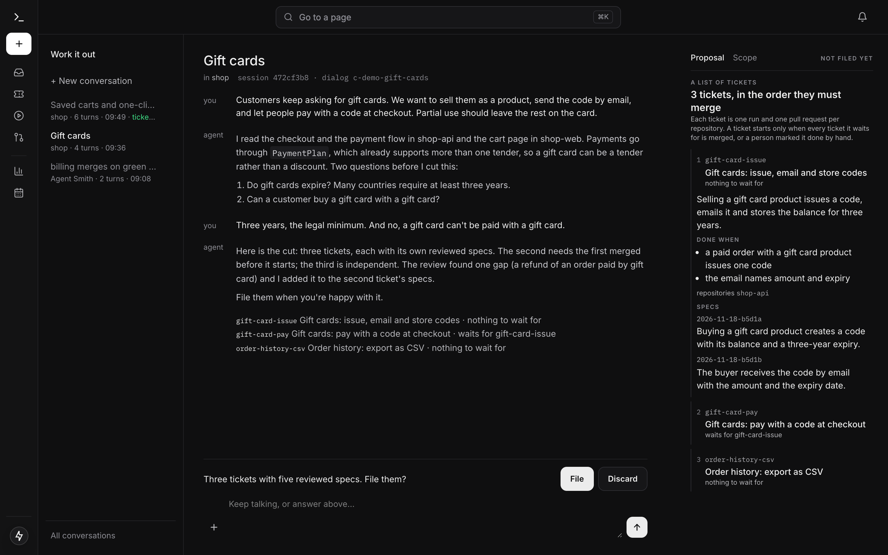
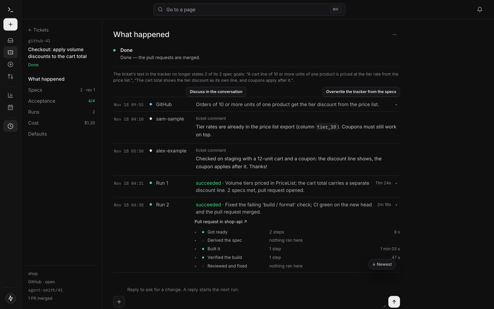
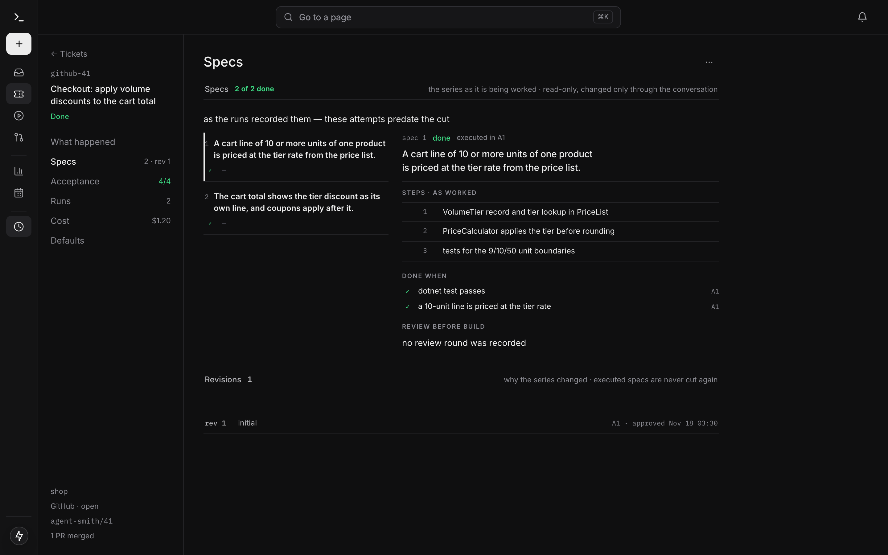
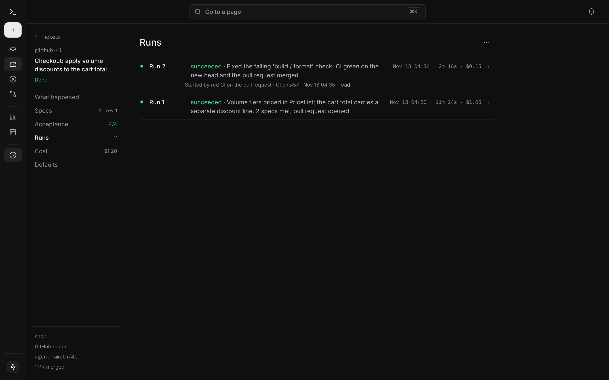
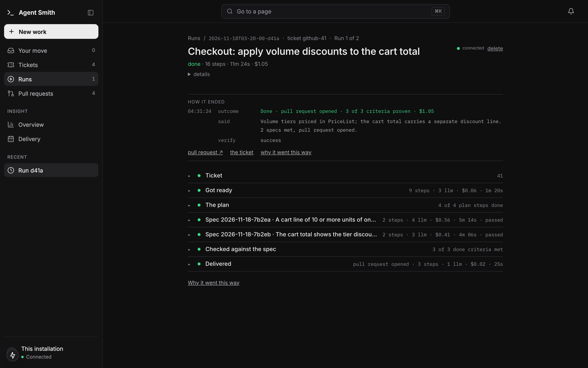
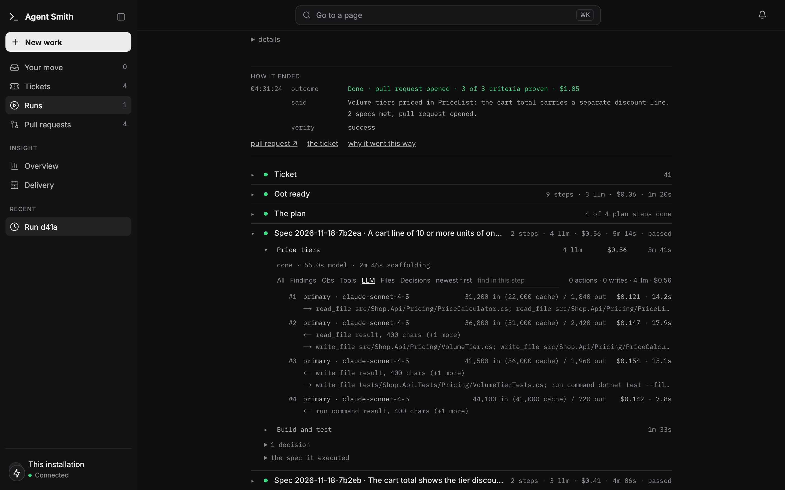
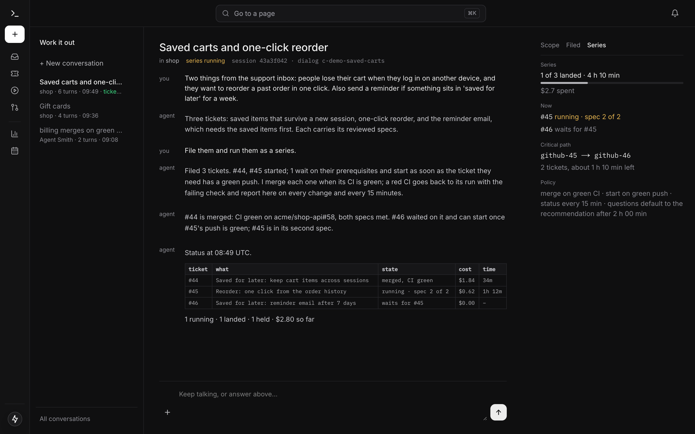

# How it works

One piece of work, from the first sentence you type to a merged pull request and a deploy. Each stage below is what the dashboard shows at that point, and links to the page with the details.

The short version:

<ol class="cb-stages">
<li><strong>You describe the work</strong> on the home page. The design partner reads your code and talks it through with you.</li>
<li><strong>It drafts tickets</strong>, each with its own specs, and reviews every spec before you see the offer to file.</li>
<li><strong>Filing</strong> writes each ticket's approved specs onto its branch. From then on the branch is the only place the specs live.</li>
<li><strong>A coding run per ticket</strong> builds those specs as written, verifies each one and opens the pull requests.</li>
<li><strong>The CI loop</strong> watches the pull requests, sends a red check back to a fix run, and merges when your policy says so.</li>
<li><strong>Dependent tickets start</strong> on a green prerequisite, stacked on its branch, without waiting for the merge.</li>
<li><strong>The series run</strong> follows all tickets of one filing, reports in the conversation and checks the result on main.</li>
<li><strong>Deploy</strong> goes through a deployment template: a GitOps pull request or a pipeline trigger, followed until it settles.</li>
</ol>

## 1. Say what you want

The dashboard opens on one question: **What should we work on?** Type the change the way you would explain it to a colleague, pick the project beside the **+**, and attach whatever you have: screenshots, a document, a folder of the old site. Send it and the conversation continues in [Work it out](work-it-out.md). Below the composer, **Your move** lists the tickets waiting for you, then the recent ones.

<figure class="cb-shot" markdown>

<figcaption>The home page. The first message opens a Work it out conversation in the project you picked.</figcaption>
</figure>

## 2. Work it out drafts tickets with reviewed specs

The design partner answers from the code it reads, not from a guess. It asks what it can't find out on its own, and once you agree on the shape it writes the draft: one ticket, or a list of tickets in the order they must merge. Every ticket carries its own specs, each with a goal, steps and a **Done when** list.

Before you see the offer, every spec has been attacked by a fresh reviewer that opens the code and answers BUILD, BUILD WITH CUTS or REFUSE. The cuts are applied in the same turn. Only then does the bar under the conversation offer **File**.

<figure class="cb-shot" markdown>

<figcaption>A list of three tickets. The pane shows each ticket's specs and its "waits for"; the bar asks "Three tickets with five reviewed specs. File them?"</figcaption>
</figure>

Nothing is filed until you press **File**. Keep talking instead and the draft changes; any change withdraws the offer until the specs are reviewed again.

## 3. Filing puts the specs on the branch

**File** starts a `file` run with a run id, listed under Runs like any other. For each ticket it creates the tracker item, writes the approved specs to the ticket's branch `agent-smith/<ticket>`, and records your words from the conversation with the approval. Tickets that wait for another one get the `requires` link.

From here on the branch is the truth. The ticket page reads the specs from the branch, the coding run builds what is on the branch, and nobody edits them by hand. To change a spec you say so in the ticket's conversation, and the change goes through review like the original did.

## 4. The coding run builds what was approved

A filed ticket's run does not derive the specs again: the review in the design turn already passed them. The master reads the code each spec touches as it is now, builds the spec, runs the repository's own build and tests, records the master's report on every **Done when** line, and moves on to the next spec.

Things it handles without stopping:

- **A premise turned out false**, but no done criterion depends on it. The run records the corrected fact, tells the master and carries on. A false premise that breaks a criterion hands the ticket back with the question.
- **The spec needs a change** to be buildable. The master revises it with `revise_spec`: the new text is schema-checked and written as a numbered revision with its reason. A second opinion is a reviewer the master briefs itself.
- **You write in the ticket's conversation while it runs.** A message from someone with `runs.control` reaches the master with its next tool result. No new run starts.

The ticket page is where you follow it. The section bar on the left splits the page into **What happened**, **Specs**, **Acceptance**, **Runs**, **Cost** and **Defaults**.

<figure class="cb-shot" markdown>

<figcaption>What happened, one line per event. Run 2 is the CI fix; its sections open in place. Above, a notice that the tracker text no longer states the spec goals, with the two ways to resolve it.</figcaption>
</figure>

<figure class="cb-shot" markdown>

<figcaption>Specs, read from the ticket branch. Read-only: they change only through the conversation.</figcaption>
</figure>

<figure class="cb-shot" markdown>

<figcaption>Runs: every attempt in one line, with how it ended, when, how long, what it cost and why it started.</figcaption>
</figure>

A run has its own page, and it reads as one log. At the top, **Now** follows what the agent is doing, and turns into **How it ended** when the run finishes. Below it come the sections Ticket, Got ready, The plan, one per spec, Checked against the spec and Delivered. Each section line says its steps, LLM calls, cost and time.

<figure class="cb-shot" markdown>

<figcaption>The run page. "How it ended" names the outcome, the pull request, the criteria proven and the cost.</figcaption>
</figure>

Click a step and it opens in place. The **LLM** filter lists its calls in order: role, model, tokens with the cached share, cost and time, then what the call was fed (`⟵`) and what it decided (`⟶`). Click a call to read its full prompt.

<figure class="cb-shot" markdown>

<figcaption>A step opened in place. Each call shows what went in and what came out, so you can see where the tokens went.</figcaption>
</figure>

More on the run page and the ticket page: [Dashboard](../reference/operations/dashboard.md). How a spec is checked: [the master's report](delivery-account.md).

## 5. CI decides when it merges

A green run opens its pull requests. What happens next depends on the project's merge policy:

| `merge.when` | What happens |
|---|---|
| `manual` (default) | A person reviews and merges. |
| `on_gate_green` | The run merges its own pull requests as its last step once every spec passed. |
| `on_ci_green` | The pull requests wait for CI. Green on all of them, and a `merge-green` run merges. Red, and a fix run starts with the failed checks' evidence, up to `ci_fix_attempts` times before the ticket comes back to you. |

Every open pull request shows its CI state on the ticket page. Details, branch protection and approvals: [CI loop and merge policy](ci-loop.md).

## 6. The next ticket starts on a green push

When ticket B requires ticket A, B doesn't have to wait for A's merge. With the default `requires_start: on_green_push`, B starts once A's run ended green with its own pull request. B's branch is cut from A's branch and its pull request targets it. When A lands, a `retarget` run moves B's pull request onto the real base. See [Stacked start](stacked-start.md).

## 7. The series run follows the whole filing

A filing of two or more tickets opens a series run. It reads the tickets' state one beat at a time, starts and retries tickets, relays questions and posts a status table into the conversation you filed from: on every change and every 15 minutes by default. A question with a recommendation takes the recommendation if nobody answers in time, and says so. You can write to it in the same conversation.

<figure class="cb-shot" markdown>

<figcaption>A series in its conversation. The table lists each ticket with its state, cost and time; the Series tab shows what runs now and what is left.</figcaption>
</figure>

When every ticket has landed, a check runs the specs' done criteria on the default branch. A failure becomes one follow-up ticket in the same series; a clean check closes it with a summary. See [Series run](series-run.md).

## 8. Deploy

A project whose context is bound to a [deployment template](../configure-it/deployment-templates.md) can deploy from the ticket page (**More** > **Deploy**) or from the series. A deploy is a run too. It opens a manifest pull request in your GitOps repository or triggers a pipeline in GitHub Actions, Azure Pipelines or GitLab CI, then follows it until it settles. An environment can promote to the next one, and environments that need approval wait for a person.

## Where to go next

- [Install](../get-it-running/install.md) and [first run](../get-it-running/first-run.md), if you haven't got it running yet.
- [Work it out](work-it-out.md) for the conversation in detail.
- [Lifecycle](lifecycle.md) for what happens inside a coding run, step by step.
- [Admin assistant](admin-assistant.md) for the conversation that reads runs and changes configuration.
