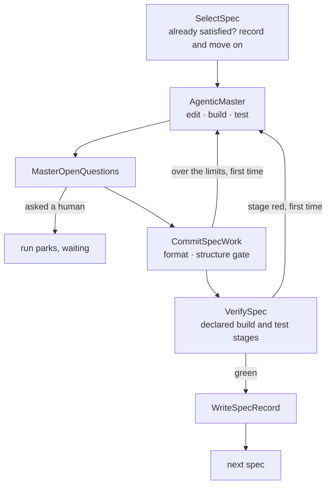

# Lifecycle

What happens between "ticket lands in the tracker" and "ticket gets set back to resolved with PR links". The diagram first, then the prose.



## In seven steps

**1. The ticket comes in.** Webhook from your tracker, or a poll round picks it up, or a CLI invocation explicitly names it. The framework parses the payload and claims the ticket — the claim is a database lease, so a webhook+poll race can't double-trigger and one ticket has at most one live run, by construction. If the run's footprint doesn't fit right now it queues FIFO instead of failing ([capacity](../reference/operations/capacity.md)). A ticket that requires another starts only once that one's run is green (stacked on its branch) or, if the project waits for the merge, once it has landed, whatever triggered it; the last prerequisite turning green starts it by itself ([stacked start](stacked-start.md)).

**2. The run reads before it provisions.** `FetchTicket` pulls the whole ticket — body, comment thread, image and document attachments. `ScopeRepos` then makes one cheap model call that does three things. It estimates the ticket's size, which sizes the run's cost budget. And it is the run's security check: a ticket that asks for something that must not be done is refused right there, parked in your `needs_clarification_status` with the offending sentence quoted, before anything is checked out. It also records the contexts the ticket names. It does not narrow the run's repositories: the run keeps the repositories an approved spec names, otherwise the project's, and the master scopes itself, opening a repository's sandbox with `ensure_repo_sandbox` as needed.

**3. Sandboxes spawn, repos get cloned.** One sandbox per repo in scope, each running the toolchain image the repo's stack calls for (declared in its `.agentsmith/` context, or pinned per language in config). The sandbox-agent binary is injected via an init-container that copies it into a shared `emptyDir`; the toolchain image itself stays unmodified. Every repo gets the work branch `agent-smith/<ticket-id>`. `RunPreflight` then proves what can be proven in seconds: the agent configuration is real, every sandbox home accepts a write, declared credentials arrived. A failed check stops the run and names the fix; a branch that already carries earlier work, or a registry with no secret, is reported but not refused. Private-registry credentials get pre-staged (`SetupRegistryAuth`), and `BootstrapGate` stops the run if a repo was never initialized.

**4. The ticket becomes a specification.** A ticket filed from a specification approved in [Work it out](work-it-out.md) or the [spec dialogue](spec-dialogue.md) works the series that is already on its branch. A ticket without one gets, from `DeriveSpec`, a stand-in per repository in scope: the whole ticket as one spec, goal = its title, done = its own criteria, committed to the ticket branch (specs under `.agentsmith/specs/planned/`, one manifest under `.agentsmith/series/`; the layout is on [the code pipeline](../reference/pipelines/fix-and-feature.md#the-specification)). No model runs in that step. The coding master writes the real spec as the first part of its work (step 5). A draft spec PR opens in every repository the series touches.

**5. The master works one spec at a time.** For each spec in order, one agentic loop (`coding-agent-master`) does the work. On a stand-in it first writes the spec — goal, steps, done lines grounded in the code — and records it with `revise_spec`. The master reads the code the spec touches itself and finds out whether the spec's premises hold. One conversation, N sandboxes routed by path prefix — file tool calls dispatch by the first path segment (`todolist-api/src/Auth.cs` → the `todolist-api` sandbox). The master briefs a sub-agent that edits the code, then reads the diff, builds and runs the repo's own tests itself and sends the work back until it holds; every command is visible in the run's timeline. Its work is committed to the branch as it goes. When it finishes, it leaves a build note for the next spec: what it renamed, moved, persisted, and where it deviated.

**6. Each spec is verified before the next one starts.** `CommitSpecWork` first runs the repository's declared formatter over the changed files and judges them against the size limits in the context's principles ([structure limits](structure-limits.md)). Then `VerifySpec` runs the verify stages each repository declares in its context (build, test, lint, whatever you wrote down). A red stage goes back to the master with its output, again while each repair changes the code and the failure; the same red again, or a repair that changed nothing, fails the spec. Green, the spec's record is [the master's report](delivery-account.md), in its own markdown, with the follow-ups it proposed through `finish_spec`. Only then does the next spec start.

**7. The PRs are finalized, the ticket gets resolved.** One PR per repository the series touches, cross-linked to each other; a repository whose specs gained no code keeps its spec PR. Before anything is pushed, the staged diff is scanned for known secret patterns — a leaked key refuses the commit. The PR body carries the per-spec table, the masters' reports and any criteria the agent declined. A complete, verified run takes the PR out of draft. The ticket transitions to `done_status`, gets a comment with the PR URLs and what the branch changed, and gets the `agent-smith:done` label. Whether the run also merges, or waits for your CI and sends a red check back to a fix run, is the project's merge policy ([CI loop and merge policy](ci-loop.md)).

## The loop inside a spec



A spec whose criteria the branch already satisfies when it is entered is recorded as "already satisfied by the branch on entry" and skipped — no master pass, no question. That's what makes a re-run on a half-finished branch cheap.

When a spec is entered, citations in it that point at code an earlier spec moved are re-grounded first, and the re-grounding shows on the ticket as a revision of the set. The master opens with the build notes of the specs before it.

The binding fence around the master is a per-ticket money-and-token budget sized from the scope estimate. The master keeps going while it makes forward progress and stops when its work is done, its budget is gone, or it needs a person. When it gives up on its own word (a red build with nothing left to try, a named blocker, criteria it calls not applicable) while a criterion is unmet and budget is left, it gets one more pass with its own reasons in front of it. A stop it repeats after that stands.

## A series over several attempts

One attempt builds at most `series.specs_per_attempt` specs (default 8), fewer when the run's wall clock left doesn't fit them. A series can hold up to `series.max_specs` (default 24), so a large one takes several attempts. The specs the attempt didn't reach stay not started.

When an attempt ends with work left in its series and nothing waiting for a person, agent-smith starts the next attempt itself. The chain of attempts has its own budget: `series.budget_usd` (default 150 USD) and `series.wall_clock_hours` (default 12 hours of summed run time). When the chain would pass either, or anything else holds it, the ticket says why once and waits. A ticket a person closed is left alone. The settings are under **Series** in [Settings](../configure-it/settings.md).

## When it goes wrong

A run always finalizes — success, shortfall, failure, timeout, cancel — and `result.md` leads with the why. It lists the files the branch carries, the run's wall-clock duration, and a failure's text once.

**Failure.** A step failed and no spec was verified. A repository gets a commit only for work the run actually did there, under a WIP subject, never `fix:`; its draft PR is refreshed with a "Run failed" banner naming the reason and never says the run completed. A run that failed before any spec ran pushes nothing beyond the series commit, so what you find is the spec PR. The ticket gets the `agent-smith:failed` label, your configured `failed_status` if set, and a comment with the failing step, the error message and the spec PR.

**Shortfall.** The run stopped after at least one spec had verified — a later spec went red, ran out of budget, or was handed back. Each sandbox is reset to its last verified commit, so work the stopped spec had begun is not shipped. The verified specs go out on a ready PR, whose body and ticket comment carry a "Not delivered" section naming every spec that was left and why. The run's status is `shortfall`, the ticket moves to your done status and carries `agent-smith:shortfall`. You decide whether to merge what's there or send it back.

**A question.** When the master needs a person, the run parks: the question goes on the ticket (mentioning the assignee, or saying nobody could be notified), the ticket moves to your `needs_clarification_status` and gets `agent-smith:waiting`, and the run releases its compute. Answer it in the dashboard, or on Azure DevOps with a comment on the ticket, and the same run picks up from the question. On the other trackers, reply on the ticket and move it back to a trigger status; the next run reads your reply. See [durable dialogue](expectations.md#durable-dialogue-checkpoint-at-the-ask-resume-on-the-answer).

Mid-run, the master's work is committed and pushed to the branch every time it marks progress, at most every `agent.checkpoint_push_min_interval_seconds` (default 120). A crashed sandbox or a killed pod loses at most the work since the last checkpoint. Each checkpoint passes the same secret scan as the final commit.

A running run renews a heartbeat in the database every 45 seconds for its whole duration, independent of how busy its steps are. A heartbeat older than the stale threshold means the server replica that owned the run is gone: the lease is released and the ticket can be claimed again. The database knows what was in flight, so a server restart reconciles instead of duplicating. Analysis stays fresh the same way — the project-map cache is keyed on the repo's HEAD SHA, so a new commit re-analyzes instead of reasoning about last week's code.

## Per-repo bootstrap

When a repo in scope hasn't been bootstrapped yet, `BootstrapGate` stops the run and names the repos that are missing their `.agentsmith/` files, followed by "Run init-project first." The `init-project` pipeline iterates the project's repos, writes a context and a `principles.md` into each, opens one bootstrap PR per repo, and cross-links them. Run it once per project (it handles all the repos in one go). What goes into a context is on [the context file](../reference/concepts/context-file.md).

## Run identifiers

Every run gets an id of the shape `{yyyy-MM-ddTHH-mm-ss}-{4hex}`: an ISO-8601 timestamp in UTC plus a 4-hex random suffix, which kills same-second collisions when a batch of tickets all queue at once. Lexicographically sortable in `ls`. The run's record directory is named after the id alone.

```
.agentsmith/runs/
├── 2026-05-22T14-03-11-9f2a/
├── 2026-05-22T14-29-44-4c19/
└── 2026-05-22T15-04-02-b7d1/
```

## Next

- [Methodology](methodology.md) — why derive / check / execute / verify are ordered the way they are.
- [How a spec is checked](delivery-account.md) — the master's markdown report and finish_spec.
- [Expectations & durable dialogue](expectations.md) — the done-list and waiting for your answer.
- [Structure limits](structure-limits.md) — the size gate at the spec commit.
- [Multi-repo](multi-repo.md) — one series across several repositories, and the path-prefix dispatch.
- [Skills catalog](skills-catalog.md) — what the master and its sub-agents are built from.
