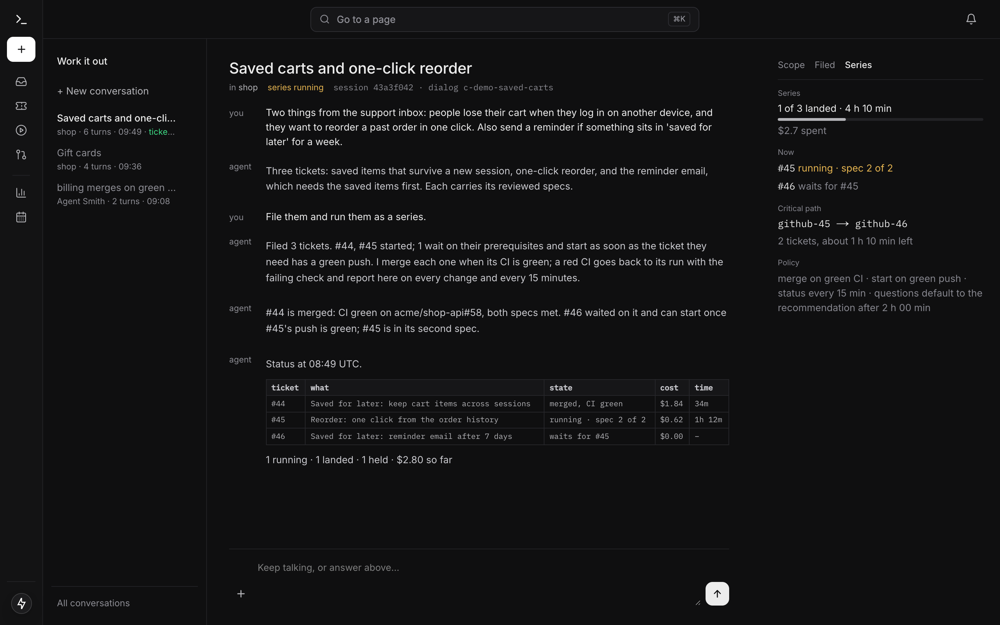

# Series run

When you file two or more tickets from one Work it out conversation, a series run looks after all of them: it starts and retries tickets, reports in the conversation, takes your messages there, and checks the finished work on main.

!!! note "Two kinds of series"
    A *ticket's* series is the set of specs one ticket builds, possibly over several attempts ([Lifecycle](lifecycle.md#a-series-over-several-attempts)). A *series run* is one level up: it follows the tickets of one filing. This page is about the second.

<figure class="cb-shot" markdown>

<figcaption>The series reports in the conversation you filed from. The Series tab on the right shows progress, cost, what runs now, the critical path and the policy.</figcaption>
</figure>

## When it opens

The `file` run that files your tickets opens the series as its last step, whenever the filing holds two or more tickets. One ticket on its own needs no series: its page and its runs are all there is.

## How it works

The series is a record, not a long-running process. Its work happens in short **beats**, each a queued run with its own run id, so no run outlives the server's wall-time limit and any server replica can take the next beat. Only one beat runs at a time.

In a beat the series master reads the facts of every ticket (state, requires, specs, pull requests, CI, cost) from the server's records, and acts through a small set of tools:

| It can | What that means |
|---|---|
| start a ticket | a filed ticket whose prerequisites allow it |
| retry a ticket | a failed attempt, once it has looked at why |
| tell a ticket | send a message to the ticket's running or next run |
| propose a re-cut | post a proposal to split or change tickets; it changes nothing until you approve |
| ask you | post a question in the conversation |
| stop the series | when going on makes no sense, with the reason |

Tickets still start and merge by the project's own rules: [stacked start](stacked-start.md) for dependents, the [merge policy and CI loop](ci-loop.md) for merging. The series doesn't watch CI itself; it reads what the CI loop recorded.

The master's own spend has a budget, `dialogue.series_master_budget_usd` (default 20 USD). The ticket runs keep their own caps.

## What you see in the conversation

The series posts an opening line saying what it filed, what started, what waits and how it will merge. After that it posts a status table on every change and at least every `dialogue.series_status_minutes` (default 15): ticket, what it is, state, cost and time, plus one summary line. Posting the table costs no model call.

The head of the conversation reads **series running**, **· 1 question for you** while a question waits, and **series done** at the end. The **Series** tab in the right-hand pane opens by default while the series runs. It shows landed of total, elapsed time, cost, an estimate once two tickets have landed, what runs now, the critical path and the policy.

## Talking to it

Write in the same conversation. A message from someone holding `runs.control` goes to the master of the running beat, or the next one.

When the master asks a question with a recommended answer, or a ticket's run parks on a question with one, the question appears in the conversation. Answer it there. If nobody answers within `dialogue.question_default_minutes` (default 120), the series takes the recommendation, posts *Taken by default at HH:mm: …* and hands the answer on: to the master, or to the parked run, which resumes. A question without a recommendation waits for you.

## The check on main

Once every ticket has landed, a `series-verify` run checks out the default branch and runs the specs' done criteria against the merged result. This is the cross-ticket check no single ticket's verification can make.

- New failures become **one follow-up ticket**, filed and started in the same series.
- A check with nothing new closes the series with a summary: cost, duration, landed, open, and *Nothing waits on you.* when nothing does.

## Settings

| Key | Default | What it changes |
|---|---|---|
| `dialogue.series_status_minutes` | 15 | How often the status table is posted when nothing changed |
| `dialogue.question_default_minutes` | 120 | When a recommended answer is taken by default |
| `dialogue.series_master_budget_usd` | 20 | The series master's own spend |

They are under **Dialogue** in [Settings](../configure-it/settings.md). The full list is in the [agentsmith.yml reference](../reference/configuration/agentsmith-yml.md).

## Next

- [CI loop and merge policy](ci-loop.md): when each ticket merges.
- [Stacked start](stacked-start.md): when a dependent ticket starts.
- [Work it out](work-it-out.md): where the series reports.
