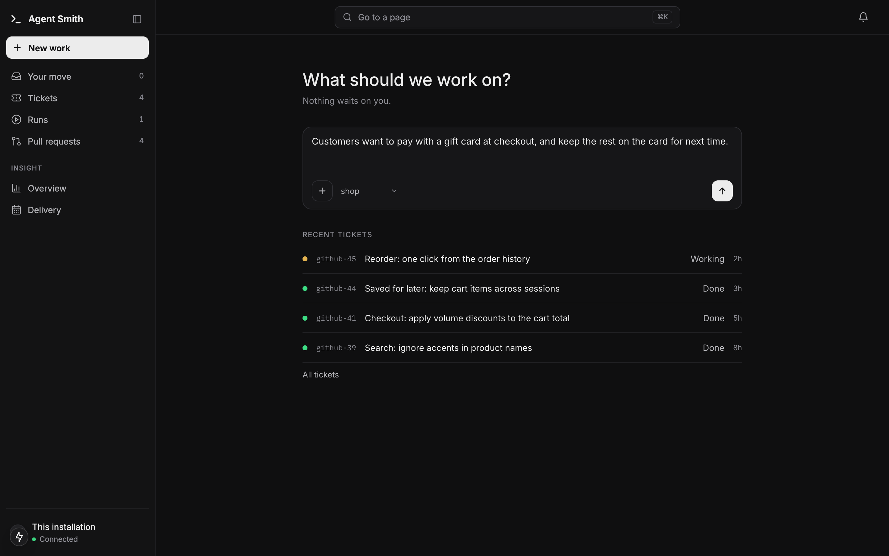
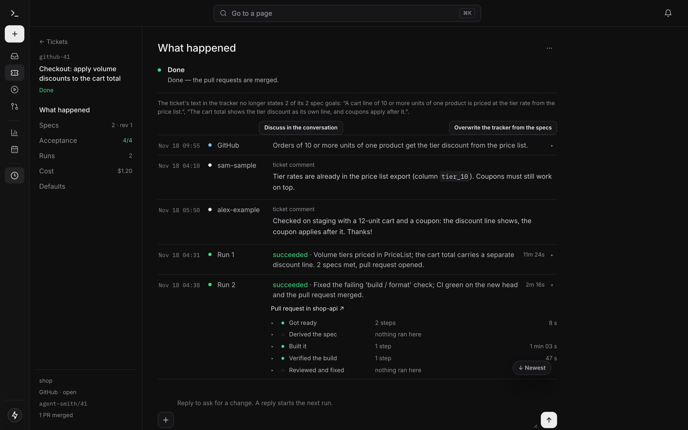
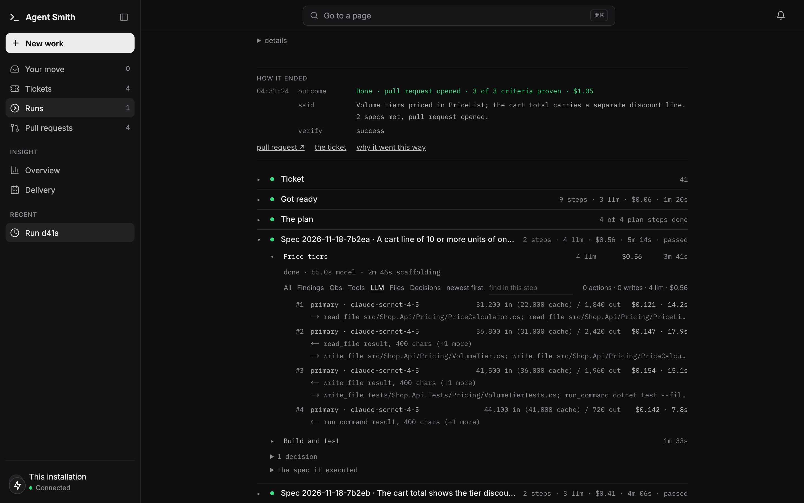

# codeably

!!! info "Formerly Agent Smith"
    codeably was called Agent Smith until November 2026. The CLI, the config file `agentsmith.yml` and the images still carry that name; their rename follows.

From ticket to PR: codeably is an open source agentic software factory, a project led by its creator, Holger Leichsenring. You drop a ticket into your tracker; it becomes a spec, the spec gets built and verified, and a PR shows up on your repo, with the ticket already updated to point at it. Every run writes down what it cost in tokens and dollars, and every change it made comes with the reasoning the agent followed. That's the whole loop.

This page is the orientation of the documentation; the product overview is on [codeably.ai](https://codeably.ai) and the source on [GitHub](https://github.com/holgerleichsenring/agent-smith). There's a fast-path link list at the bottom — if you're here to ship today, skip the rest and jump straight in.

## What it does

You describe a change, or drop a ticket into your tracker. codeably reads your code and turns the work into specs: per spec a goal, the steps and the list of what has to be true when it's done. It clones every repository the work touches into its own sandbox on your infrastructure, builds the specs one at a time, runs each repository's own build and tests, and checks every done criterion against the branch with the evidence it found. Then it opens one pull request per repository, cross-linked, and writes the ticket back. If the ticket is too thin, it asks instead of guessing.

<ol class="cb-stages">
<li><strong>Describe it.</strong> The home page asks "What should we work on?" and hands your first message to <a href="how-it-works/work-it-out/">Work it out</a>, a conversation with an agent that reads your code while it answers.</li>
<li><strong>Approve reviewed specs.</strong> It drafts one or more tickets, each with specs a fresh reviewer has already attacked. You press File.</li>
<li><strong>It builds and verifies.</strong> A run per ticket builds exactly the approved specs, verifies each criterion and opens the pull requests.</li>
<li><strong>It merges on your terms.</strong> By hand, when the run is green, or when your CI is green, with red checks sent back to a fix run.</li>
<li><strong>It reports.</strong> Every run records what it cost in tokens and dollars and why it did what it did.</li>
</ol>

The whole flow, stage by stage with pictures: [How it works](how-it-works/end-to-end.md).

<figure class="cb-shot" markdown>

<figcaption>The dashboard's home page. Everything starts from one sentence.</figcaption>
</figure>

## Watch it work

A ticket has one page. The section bar on the left splits it into what happened, the specs as they stand on the branch, the acceptance verdicts, every run, the cost and the defaults the agent chose on its own. A run that needs a decision it shouldn't make alone asks there, and no tokens burn while it waits.

<figure class="cb-shot" markdown>

<figcaption>A ticket page: comments from the tracker, two runs, and the second one's log opened in place.</figcaption>
</figure>

A run reads as one log. Open any step and you see each LLM call in order, what it was fed, what it decided and what it cost.

<figure class="cb-shot" markdown>

<figcaption>A step opened in place, its LLM calls numbered with role, model, tokens, cost and time.</figcaption>
</figure>

On a server the configuration lives in the database and is edited in the dashboard: agents, trackers, repositories and secrets wired into projects, every reference picked from the catalog, every edit attributed and revertible. See [The Config studio](configure-it/config-studio.md).

## What lands on disk after a run

Every run gets a directory under `.agentsmith/runs/`, named by the run id: a UTC timestamp plus a 4-hex collision suffix.

```
.agentsmith/runs/2026-05-22T14-03-11-9f2a/
├── plan.md       — the master's working plan, when it wrote one
└── result.md     — what got done, the master's report, cost in tokens and USD
```

Next to it, the spec a run executed sits under `.agentsmith/specs/`, and the choices it made go into `.agentsmith/decisions/`, each naming what it picked and what it beat. That's the why-record. Long after, when you've forgotten why the agent picked path A over path B, the answer is in there. That was the reason we built it this way: we got tired of code we couldn't reverse-engineer.

## What's supported

**Trackers** — these are the ticket sources codeably reads from and writes back to.

| Tracker | Trigger modes | Connect page |
|---|---|---|
| Azure DevOps Boards | webhook · polling · label | [Azure DevOps](connect-your-stuff/tracker-azure-devops.md) |
| Jira | webhook · polling · label | [Jira](connect-your-stuff/tracker-jira.md) |
| GitHub Issues | webhook · label | [GitHub Issues](connect-your-stuff/tracker-github-issues.md) |
| GitLab Issues | webhook · polling · label | [GitLab Issues](connect-your-stuff/tracker-gitlab-issues.md) |

**AI providers** — codeably calls these directly from your infrastructure. You pick the model per role (a cheap one for scout passes, the good one for the actual code).

| Provider | Notes |
|---|---|
| Anthropic Claude | First-class. Prompt caching on by default. |
| OpenAI | First-class. Reasoning models supported. |
| Azure OpenAI | Same as OpenAI plus per-deployment routing. |
| Google Gemini | First-class. |
| Ollama | Local models. No API key, no internet. |
| GitHub Copilot | Runs on a Copilot seat you already pay for. |

See [Connect your AI provider](connect-your-stuff/ai-providers.md) for the config blocks.

**Skills** — the masters that drive each pipeline and the rules they follow are developed in a separate repo, `github.com/holgerleichsenring/agent-smith-skills`, and every release ships with its catalog embedded: the binary you download already carries the exact skills it was tested with. Nothing to pin, nothing to fetch on first run. A `skills:` block in `agentsmith.yml` is only for overriding that — skills development, air-gap mirrors. See [Skills catalog](how-it-works/skills-catalog.md).

## Get running today

The pages below are the fast-path. The only thing step 2 needs is an API key for an AI provider — everything else comes later.

1. [Install](get-it-running/install.md) — CLI binary, Docker image, or k8s.
2. [First run](get-it-running/first-run.md) — `agent-smith demo` proves the whole loop on a bundled sample project. One LLM key, no tracker, no Docker, minutes.
3. [Connect your tracker](connect-your-stuff/tracker-azure-devops.md) — pick the page for your tracker.
4. [Connect your repos](connect-your-stuff/repos-mono.md) — single repo, or [multi-repo](connect-your-stuff/repos-multi.md) if your project spans more than one.
5. [Connect your AI provider](connect-your-stuff/ai-providers.md) — the config block for the provider you have.
6. Point the loop at a real ticket: `agent-smith code --ticket 54 --project todolist` — the [first-run page](get-it-running/first-run.md) walks it end to end. `agent-smith doctor` before that tells you whether the wiring holds.

Then [pick a trigger mode](trigger-it/webhooks.md) (webhook is what you want for production) and [pick a host setup](host-it/docker-compose.md) (docker-compose is the easiest, k8s is what you want for shared use). Once it runs server-side, the [dashboard](reference/operations/dashboard.md) is where you start work and watch it.

## How it works, when you have time

- [End to end](how-it-works/end-to-end.md): the whole flow with pictures.
- [Work it out](how-it-works/work-it-out.md): the conversation before the ticket, and the ticket's own conversation.
- [Lifecycle of a run](how-it-works/lifecycle.md): what happens between ticket-in and pull request.
- [How a spec is checked](how-it-works/delivery-account.md): the coding master reports on every done line with evidence and proposes follow-ups; the build and tests gate the spec.
- [CI loop and merge policy](how-it-works/ci-loop.md), [Stacked start](how-it-works/stacked-start.md) and [Series run](how-it-works/series-run.md): what happens after the pull request.
- [Methodology](how-it-works/methodology.md): spec first, then code, then an account of what got delivered, and why.

Everything else lives in Reference: the per-pipeline pages, the full [agentsmith.yml schema](reference/configuration/agentsmith-yml-schema.md), the [architecture deep-dives](reference/architecture/index.md) and the historical run logs.

## Who is behind it

codeably is led by its creator, Holger Leichsenring, and shaped by the teams that use it in production. Contributions are welcome, see [CONTRIBUTING.md](https://github.com/holgerleichsenring/agent-smith/blob/main/CONTRIBUTING.md). Companies that need a contract, an SLA or onboarding work with [45level](https://45level.com), the project's professional-services partner; see [services](https://codeably.ai/services).

How the project is run and who decides what is in [GOVERNANCE.md](https://github.com/holgerleichsenring/agent-smith/blob/main/GOVERNANCE.md).

## License

MIT. Copyright (c) 2026 Holger Leichsenring. Source at [`github.com/holgerleichsenring/agent-smith`](https://github.com/holgerleichsenring/agent-smith).
