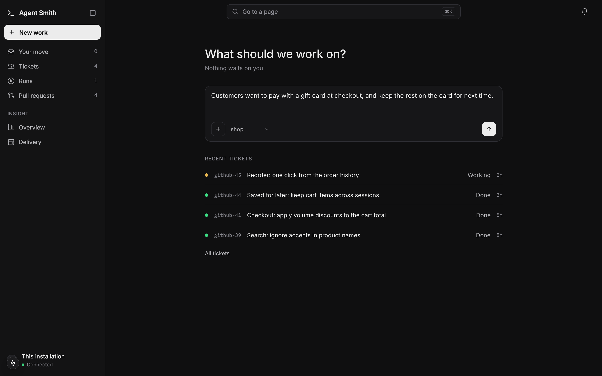
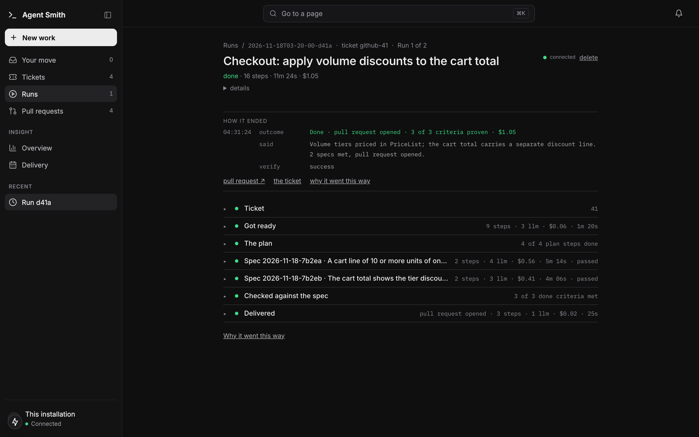
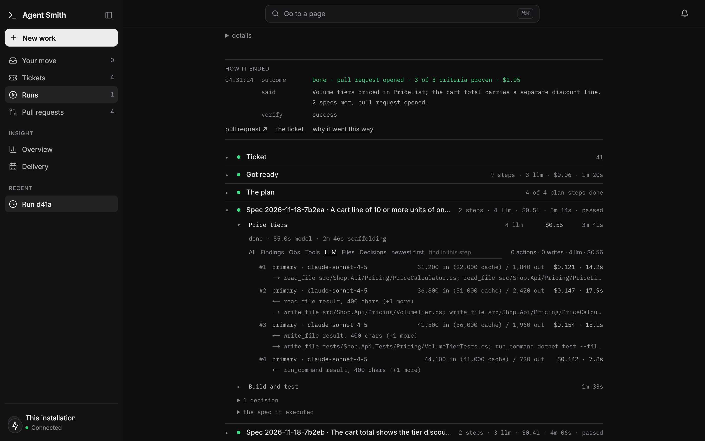
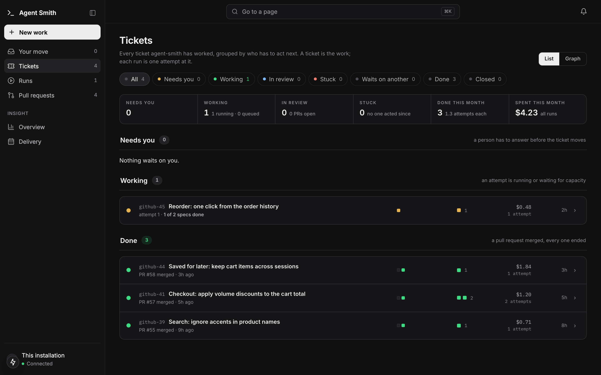
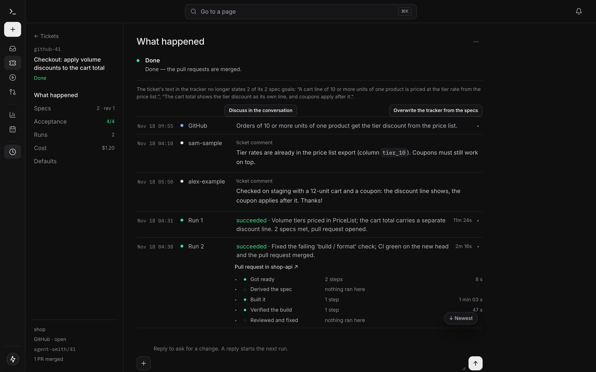
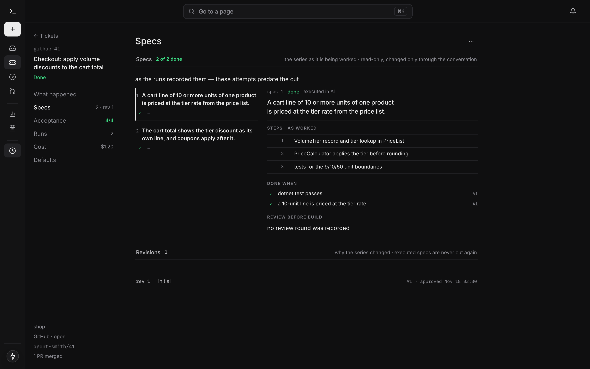
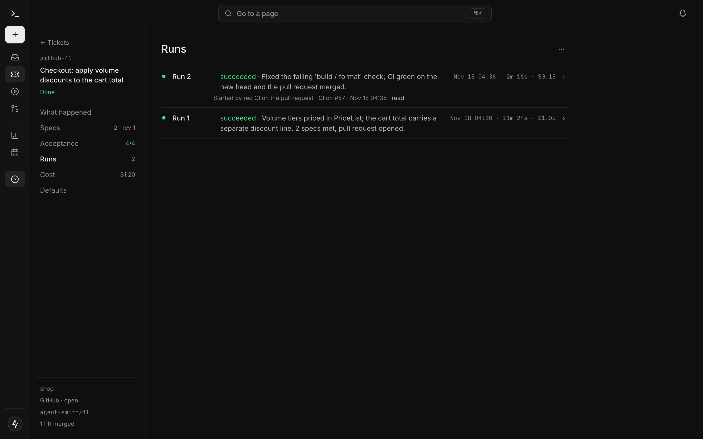

# Dashboard

The web UI for watching what codeably is doing, and, just as important, what it did last Tuesday and what that cost. It reads from the server's database and live event stream. It also writes: it cancels, answers, deletes and initializes runs, and it's where the configuration is edited, because on a server the configuration lives in the database and nowhere else.

<figure class="cb-shot" markdown>

<figcaption>The home page and the sidebar. Every page sits under the same shell.</figcaption>
</figure>

## Running it

The dashboard is a Next.js app shipped as its own image (`holgerleichsenring/agentsmith-dashboard`), listening on port 3000.

- With docker-compose it sits behind the `dashboard` profile of `deploy/docker-compose.example.yml`: `docker compose --profile dashboard up -d`, then open `http://localhost:3000`.
- On Kubernetes it's `deploy/k8s/10-deployment-dashboard.yaml` plus `11-service-dashboard.yaml`.

The dashboard proxies `/api/*` and `/hub/*` to the server (`AGENTSMITH_BACKEND_URL`, in compose `http://server:8081`), so the browser stays same-origin. The server's UI API allows loopback callers always and other origins via `AGENTSMITH_DASHBOARD_ORIGIN`.

### Sign-in

Out of the box nobody signs in and nothing is refused. Give the dashboard an OIDC authority and it signs people in itself, with the authorization code flow and PKCE, as a public client. There is no client secret, and there's nowhere to put one.

The settings are environment variables on the dashboard container:

| Variable | What it is |
|---|---|
| `AGENTSMITH_AUTH_AUTHORITY` | The OIDC authority. The same variable the server reads, so one value in a compose `.env` serves both. |
| `AGENTSMITH_AUTH_CLIENT_ID` | The public client registered for the dashboard. Without it, or without an authority, sign-in is off. |
| `AGENTSMITH_AUTH_AUDIENCE` | Sent as an `audience` parameter when set. Also shared with the server. |
| `AGENTSMITH_AUTH_SCOPES` | The scopes requested, space-separated. Defaults to `openid`. |
| `AGENTSMITH_AUTH_REDIRECT_PATH` | Where the authority sends the browser back. Defaults to `/signin-callback`. |

They're not baked into the bundle. The image's entrypoint writes them into `/app/public/runtime-settings.json` when the container starts (override the path with `AGENTSMITH_RUNTIME_SETTINGS_FILE`), so changing one is a restart, not a rebuild. That file is served to any browser that asks, which is fine for an authority and a public client id and is exactly why a secret must never go in there.

Two things only you can set, on the authority's side and in the scopes:

- Register the reply URL (`https://<dashboard>/signin-callback`, or your redirect path) as a single-page application, not as a web application. Otherwise the authority refuses the browser's own token redemption.
- Put `offline_access` in `AGENTSMITH_AUTH_SCOPES`. The session is kept in the tab's session storage and survives a reload, but without a refresh token there's nothing in it that outlives the first access token, usually an hour.

Once the server enforces sign-in, a tab with no session is sent to your organisation's sign-in page once on its own. After that, or when a session expired or its renewal was refused, the page says which of those happened and offers a **Sign in** button, instead of pretending the server is offline. The header shows the account: who is signed in, **Your identity** and **Sign out** behind it.

Two banners watch the pairing between dashboard and server. When only one half has an authority, it says "Sign-in is configured on one side only." When the two name different authorities and a token actually got refused over it, it says "The two halves of sign-in name different authorities." What the server expects is readable without a token at `GET /api/auth/requirements`, which is how the dashboard knows before anyone signs in.

A `401` renders as a sign-in state, a `403` names the permission that was missing. Who holds which permission, the identity page and the server's own `auth:` block are on [Access control](../security/access-control.md).

## The shell

Every page sits beside one sidebar and under one top bar. The top bar has **Go to a page** (⌘K), which jumps to any page by name, and a bell that opens what needs you.

The sidebar holds the work and nothing that is a setting:

- **New work** opens the home page's question, *What should we work on?*, whose first message starts a [Work it out](../../how-it-works/work-it-out.md) conversation.
- **Your move**: the tickets that wait for you, with their count.
- **Tickets**: every ticket, by state. See [Tickets](#tickets).
- **Runs**: every run, at `/runs`. See [Runs](#runs).
- **Pull requests**: what the agent shipped.
- **Insight**: **Overview** and **Delivery**.
- **Recent**: the last few pages you opened.

The sidebar collapses to icons, and does so by itself on the ticket and Work it out pages, which bring a section bar of their own. At its bottom sits the profile menu with **Settings** (the [Config studio](../../configure-it/config-studio.md) at `/config`), **Access**, **Installation**, **System**, and your identity and sign-out when sign-in is on.

The home page (`/`) asks what to work on: a composer with the project picker beside the **+**, files held until you send, and beneath it **Your move** (at most three tickets that need you) and the recent tickets.

Three banners can appear above every page. A blocking startup finding shows "Running degraded", naming each finding (see [server resilience](server-resilience.md#startup-findings)). A build mismatch between the page and the server shows an advisory banner with a **Reload** button; the server withholds it for the first ten minutes after it starts, because two builds side by side is what a rolling upgrade looks like. And the sign-in banners above.

## Runs

`/runs` is split into buckets, with filter pills above the list, under a strip of counts (waiting for input, running, queued, finished today, cost today):

- **Waiting for input** lists runs parked on a question. A row opens the run, where the question is answered; a ticket's question is also answered on the ticket list. More on parking in [durable dialogue](../../how-it-works/expectations.md).
- **Running** shows each run's step progress, cost so far and age.
- **Queued** shows each run's place in line (`pos 3`) and the reason it's waiting. A parked run whose answer is in and whose relaunch is waiting for a slot moves here too and reads `resuming · pos 2`, instead of still claiming to need you.
- **Finished** pages back through history with **Load more**. Its header carries **clear finished**, which deletes every finished, failed and cancelled run at once (see [Deleting runs](#deleting-runs)); it shows only while there is a finished run, and not to a signed-in caller without `runs.delete`.

Finished runs say how they ended: done, done with a shortfall (the verified specs shipped and the rest is named as not delivered), failed, or cancelled, each distinct. Every row carries a delete button, which asks for a second click before it acts.

### Run detail

One run reads as one log, top to bottom, in plain text.

<figure class="cb-shot" markdown>

<figcaption>A finished run. The sections start closed; a running or stopped one starts open.</figcaption>
</figure>

The header names the run: **Runs / run id · ticket · Run n of m**, the title, and one line with the state, the steps, the time so far (or in total), the cost against the run's cap, the pods and their memory, and the work shape. The cost turns amber past 80% of the cap and red over it. **details** opens everything else the run recorded: when it started and finished, the model and its call count, the repositories, the pipeline, the run id, where the time went (model, sandbox, scaffolding, throttled), the share of the budget spent and its tier, the reserved Gi·min, why the run got its shape, the live sandbox command count, and the pods with image and memory (or the reservation while none has landed).

Under the header, **Now — follows the agent** shows the last few things the agent did, as they arrive: the step it is in with what it says it is doing, the last command it ran, its newest decisions, tool calls, files written and findings. A run that waits on you shows its question with the answer form here, and that its compute is held. A queued or resuming run says its place in line. Once the run ends the block becomes **How it ended**: the outcome with its pull requests, criteria and cost, the run's own end text, the step it stopped at and what to set to lift the stop, the review's result and the last verify pass per repository. Its links open the pull requests, **Retry unchanged** (on the ticket's newest attempt, when it did not succeed), the setting, the ticket and the Why page.

The log itself has a section per piece of work: **Ticket** (the ticket as the run read it, with its tracker link), **Got ready**, **The plan** (the work spec, the agreed plan and the progress ledger), one section per spec, **Checked against the spec** and **Delivered** (the pull requests and the run report, `result.md`). A run without specs reads Got ready, The work, Delivered. Every section and step line says its LLM calls, cost and time; internal steps and silent gates fold into one "mechanics" line per section. A running or stopped section starts open.

<figure class="cb-shot" markdown>

<figcaption>A step opened in place, filtered to its LLM calls. <code>⟵</code> is what the call was fed, <code>⟶</code> what it decided.</figcaption>
</figure>

Click a step and its detail opens in place: its status, where its time went and its result message, each repository's outcome, then every LLM call (role, model, tokens in and out, cached tokens, cost, duration), command (exit code, duration, a timeout and its limit), write, decision, finding and observation, newest first. Filter with **All · Findings · Obs · Tools · LLM · Files · Decisions**, flip the order, search the step, **show all**, and page back into older events. The open step is in the address (`?step=24`), so a link lands on it; older `#n=step-24` links still work. A run whose cached share is 0% has a dead prompt cache, which is an alarm, not a detail (see [cost tracking](../concepts/cost-tracking.md)).

In **Checked against the spec**, each done line shows what the spec's master reported — met, not applicable or not met — with the evidence it cites and its why. When you think a line is wrong, **this verdict is wrong** records your own judgement with a reason. That's a label for later measurement; it doesn't re-open anything. How the report comes about is on [how a spec is checked](../../how-it-works/delivery-account.md).

The header of the detail page carries **cancel** and **delete**, both with a confirming second click. Cancel enforces: graceful window, then force-kill, pods released ([cancel semantics](capacity.md#cancel-is-a-state-not-a-wish)). Failures lead with why: a cancelled run says who cancelled it, a timeout names the limit that fired.

### Why this run did that

The live view answers "what is happening". **Why this run did that** (`/jobs/{id}/why`) answers the other question, after the fact. It shows what the ticket cost, broken down by pipeline steps and by sandbox commands with count and duration, then one account per spec: its calls plotted prompt size against answer size, the commands and how they ended, and the calls in full. The recorded conversation can be read from there too.

### Deleting runs

Deleting a run removes it and everything it left behind, including the judgements recorded on its acceptance criteria. A run that hasn't finished is cleared first: its pod is terminated, its lease released, its queue entry dropped, and its ticket disarmed with a comment, so the next poll doesn't pick it up again as a fresh run. A finished run's ticket is left alone, that one's yours to move. If the pod can't be terminated the record is kept and the delete fails with a `502`, so you can retry once the backend answers.

The same over HTTP, both needing `runs.delete`:

```bash
curl -X DELETE https://agentsmith.example.com/api/runs/<runId>
curl -X DELETE "https://agentsmith.example.com/api/runs?state=terminal"   # every finished, failed and cancelled run
```

The bulk form only ever touches terminal runs, so it can't kill a live one. It is what **clear finished** on the runs board calls; its confirming second click says that the finished runs and their verdict history go.

### Retrying an ended attempt

`POST /api/runs/{runId}/retry` (needs `runs.control`) starts the same work again, unchanged, after any end but a success: a failure, a cancel, an infrastructure loss or a shortfall. The run must be the ticket's latest attempt and finished. A `202` means the retry is recorded and queued: the rework worker moves the ticket from `failed_status` back to the first trigger status and starts one attempt, whose cause names you with channel `retry`. If the worker can't start it (the tracker offers no move, say), it says so on the ticket, and you can retry again.

Every refusal is a `409` with one body, `{reason, text, project, ticketId}`. `reason` is `not-latest`, `handed-back`, `not-finished`, `delivered`, `closed-for-work` or `starting`; `text` is the sentence to show. A hand-back and a delivered success are answered in the ticket conversation, where approving a change starts the next attempt; a ticket a person closed in its tracker gets a linked follow-up from an approval there instead of being reopened. A `503` means the tracker couldn't be read, and nothing was recorded.

## Tickets

`/tickets` lists every ticket codeably knows about. That is a ticket with at least one code run, where each run is one attempt at it, and a ticket filed from Work it out that has not run yet. It needs `runs.read`. Tickets are grouped by who acts next, under a row of figures (what needs you with the oldest wait, what's working, what's in review, what's stuck, done this month and this month's spend). Filter pills above the list pick one group; the rarer ones show only while they hold tickets. Every ticket sits in exactly one section:

<figure class="cb-shot" markdown>

<figcaption>The ticket list, grouped by who acts next. <strong>List | Graph</strong> switches to the dependency graph.</figcaption>
</figure>


- **Needs you**: the newest attempt is parked. A question is answered in place, and **Send & resume attempt n** resumes that attempt. A hand-back shows the words it posted and leads into the ticket's conversation in Work it out, because there is no paused run to resume.
- **Working**: an attempt is running or waits for capacity.
- **Waiting on review**: a pull request is open and a person owns the next move. The row names the review decision and who made it, and says when a request for changes came from someone who is not a trusted reviewer.
- **Stuck**: the last attempt failed and a check saw the ticket unchanged and untouched since.
- **Waits for another ticket**: filed, no run on record, and a ticket it requires has not landed yet (merged, or marked done by hand). How requires are filed and when a held ticket starts is on [Ticket dependencies](../../how-it-works/ticket-dependencies.md).
- **Filed, no run on record**: filed, nothing it requires is still open, and no run has been recorded.
- **Ended**: no next step is running or waiting, such as a cancelled attempt, a success without a pull request, or pull requests that were all closed unmerged. The dot follows how the last attempt ended, except that pull requests all closed unmerged draw it red.
- **Done**: a pull request merged and every other one ended (merged or closed), or a person marked the ticket done by hand. Collapsed to this month's count until **Show done**. Pull requests that were all closed unmerged are not done.

Each row shows the ticket's progress through its specs and pull requests, a mark per attempt, the summed cost and the age, and opens the ticket's page. A section holding more tickets than the page loaded ends with **Show all**, which opens its bucket view. On the runs list, a code run of a ticket opens the same page; any other run opens its run viewer.

### The graph view

The **List | Graph** switch at the top of `/tickets` draws every ticket that requires another or is required by one, with an arrow from each ticket to what it requires. The view lives in the URL (`/tickets?view=graph`), so you can link to it. Each node carries the tracker key, the title and its state: merged or done by hand, running, blocked, ready, or "no run · no page". A node with a ticket page opens it. A node without one (a ticket someone wrote by hand in the tracker and named as a requirement, say) opens a small panel with what requires it and the **Mark done by hand** act. When no ticket requires another yet, the view says so. The same graph is `GET /api/tickets/graph` (optionally `?project=`), with `runs.read`.

### Marking a ticket done by hand

Sometimes a required ticket is finished without a merge agent-smith could see: shipped by hand, solved elsewhere, dropped on purpose. **Mark done by hand** counts it as landed. The dialog asks for a note (it's required: why does this ticket count as landed?) and says what follows, namely that the tickets waiting for it stop waiting, and that it can't be undone. The act needs `runs.control`, because a landing can start every ticket that waited for it. It appears on a ticket page's header, beside each unlanded entry under **Waits for**, and on a page-less graph node, and is hidden from a caller known to lack the permission and on a ticket that already landed.

Over HTTP it is `POST /api/tickets/{project}/{ticketId}/landed-by-hand` with `{"note": "…"}`. The tracker has to know the ticket before anything is recorded. Every refusal is a plain sentence: a missing note (`400`), an unknown project or ticket (`404`), a ticket that already landed, with who marked it and when or when it merged (`409`), or a tracker that could not be read (`503`, nothing recorded).

### A ticket's page

`/tickets/{project}/{ticketId}` is the ticket. A section bar on the left names the ticket (its key, title and state) and splits the page into six sections, one shown at a time and addressed by `?section=`: **What happened**, **Specs**, **Acceptance**, **Runs**, **Cost** and **Defaults**, each with its count. Under them sit the ticket's facts: project, tracker and its state, the work branch, and its pull requests with their CI (`CI green`, `CI pending`, `CI red: build, lint`).

<figure class="cb-shot" markdown>

<figcaption>What happened. One line per event, a run opening its log in place, the composer at the bottom.</figcaption>
</figure>

Beside the section's heading stand **Cancel run n** while an attempt runs, and **···** for everything that is not the next step: open the ticket in its tracker, **Mark done by hand** (see [above](#marking-a-ticket-done-by-hand)), close or reopen, derive the specs again, and **Deploy** where the project has a [deployment template](../../configure-it/deployment-templates.md). Each act runs as a pipeline with a run id and shows under Runs.

**What happened** is the ticket's conversation, one line per event: tracker comments and text edits, run questions and answers, pull-request reviews, the spec cut, each run with its outcome and how it ended. Equal stops fold into one line ("Runs 3–5 · 3× same cause"). A run opens its sectioned log in place. When something waits for you, a **Your move** line sits on top and names it. At the bottom, the composer: a reply asks for a change and starts the next run; while a run is working, a message from someone with `runs.control` reaches that run instead. A ticket waiting for others lists them first under **Waits for**.

When the tracker's text no longer states what the approved specs say, a notice names the goals it lost and offers **Discuss in the conversation** or **Overwrite the tracker from the specs** (a `ticket-body` run).

**Specs** shows the ticket's specs as they are on its branch: per spec its goal, the steps as worked, **Done when** with each criterion's state, the review rounds before it was built, its build note and its revisions. It's read-only. A spec changes through the conversation, never by hand, and a filed ticket that never ran shows the set on its branch. The section ends with the derivations, their duration, and **Derive again**.

<figure class="cb-shot" markdown>

<figcaption>Specs, read from the ticket branch.</figcaption>
</figure>

**Acceptance** lists every done line with the master's report on it, its why and the evidence, with a link to the run that reported it ([how a spec is checked](../../how-it-works/delivery-account.md)).

**Runs** lists every attempt and derivation, act runs included (`merge-green`, `retarget`, `refresh-base`, `deploy`), one line each: outcome, how it ended, start, duration, cost, a link to the run and what caused it. A deploy also shows its pull request or pipeline run with any failed checks.

<figure class="cb-shot" markdown>

<figcaption>Runs, one line per attempt.</figcaption>
</figure>

**Cost** is the total against the series budget with a thin bar, a line per run, and the compute behind it: pod time, memory reserved, model call time and time spent waiting on you.

**Defaults** holds the choices the agent made on its own, the ones no person had to make before work could go on, and the memories it proposed. Each says where it was taken, the spec, what was asked, what was chosen instead of what, and why. Pending ones come first; one that holds the series is marked, because the series doesn't start its next attempt while it waits.

### A ticket's series over several attempts

A ticket holds at most `series.max_specs` specs (24 by default), and one attempt runs at most `series.specs_per_attempt` (8 by default, and only as many as fit the run's wall clock). When an attempt ends with specs left and nothing waits for a person, codeably starts the next attempt itself, inside a budget for the whole chain: `series.budget_usd` (default $150) and `series.wall_clock_hours` (default 12). The Cost section shows the spend against that budget. This is the series *of one ticket*; the [series run](../../how-it-works/series-run.md) that follows the tickets of one filing is something else.

## Pull requests

**Pull requests** in the rail lists what the agent shipped: open today, this week and in total, then every opened PR with a link out to the provider and back to its run. Underneath, **No PR** lists the runs that produced no pull request, and why.

## Overview

**Insight → Overview** is the reading of the system rather than a part of it. Three cards over two panels:

- **Spend · 7 days**, today and the trailing week with the LLM calls behind it. The panel **Where the money went** breaks the week down by repo and pipeline. Every figure is grouped from the run list the dashboard already holds; there's no separate cost endpoint and no second truth.
- **Runs**, the same buckets the rail counts, with the finished ones split into succeeded, failed and cancelled.
- **Criteria met**, the share of acceptance criteria that finished `code` runs met: met over met, unmet and unproven, with not-applicable criteria counted on neither side. The panel **Criteria outcomes** breaks it down per project and per month of the run's finish (UTC). An operator's overrule of a criterion counts while the status it answered is still the run's; once the run has been judged differently it is shown as stale and not applied. Runs of other pipelines are not counted, and a share never renders as 0% without a measurement.

## System

The System entries answer "is this thing alive and why didn't my ticket trigger":

- Per subsystem (tracker polling, webhooks, chat dispatchers, config reads) a status with live/idle freshness and a live event tail.
- The trigger log: every received webhook and poll cycle with its verdict, actioned, or skipped with the reason (no matching project, no trigger label, signature invalid).

Each subsystem has its own address under `/system/…`, so a selected one survives a reload and can be linked. A few older addresses still work and lead to where their content lives now: `/system/today`, `/system/cost` and `/system/expectations` open the [Overview](#overview), `/system/installation` opens `/config/installation`, and `/system/connections` opens `/config/connection-check`.

## This installation

**Installation** (`/config/installation`) says which build of codeably this installation runs: the server's release and revision, the dashboard's, and the sandbox agent's per project (or "not stated by this build" when a locally built image carries no stamp). Below that the skill catalog the server is **Bound to** and, labelled separately, the **Embedded floor** the binary was built against. Then the database: provider, and whether migrations are pending, with the command that applies them. The report behind the page, `GET /api/config/installation`, answers without a token, because which build is running is the question you ask when nothing else answers. The same page takes and restores [data archives](data-archive.md).

**Connection check** is the runtime diagnostics page: every configured connection (trackers, repo connections, LLM agents, sandbox backend, Redis, database, chat adapters) with a probe button per row and a "Test all". A probe is the cheapest authenticated call against the real dependency, so a red row is a real problem, named. Webhooks get a "secret configured / last delivery seen" panel instead of a probe button, since the server can't actively probe an inbound webhook. The same probes back `agent-smith doctor` and the server's startup preflight on `/health`.

**Changes** is the audit trail of every configuration change.

## Configuration studio

On a server, the database is the store of record for configuration, and this is where you edit it. Reached from **Settings** in the profile menu, **Configuration** is a relational catalog (projects, agents, trackers, repositories, connections, MCP servers, [design sources](../../configure-it/design-sources.md), secrets) that you create and edit in place. Refs are picked, never typed: a project points at its agent, tracker and repos by choosing them from the catalog, so it can't reference an agent that doesn't exist, and a connection-scoped repo ref either resolves or is flagged. Changes apply while the server runs.

**Import agentsmith.yml** and **Export agentsmith.yml** move the catalog in and out of the file format the CLI reads. Secrets are referenced by name, never shown. The whole picture, including what a server still reads from the file, is on [Where configuration lives](../../configure-it/index.md) and [the Config studio](../../configure-it/config-studio.md).

## Catalog

The Catalog view shows the loaded skills catalog: every skill and master with its rendered SKILL.md, the concept vocabulary with types and definitions, and where the catalog came from. The origin line points at the setting that decides it, Settings → Skills, and says when an overlay directory on the server is layered over the source, since no setting in the dashboard changes that one. A saved change to the source shows up once the server resolves the catalog again, which the next pipeline run does. The run detail's "Load catalog" step shows the same for a specific run.

## Next

- [Capacity & queueing](capacity.md): what a queued run is waiting for and how to size the knobs.
- [Server resilience](server-resilience.md): `/health`, startup findings and the degraded banner.
- [Access control](../security/access-control.md): sign-in, roles and permissions.
- [Cost tracking](../concepts/cost-tracking.md): the numbers behind the cost columns.
