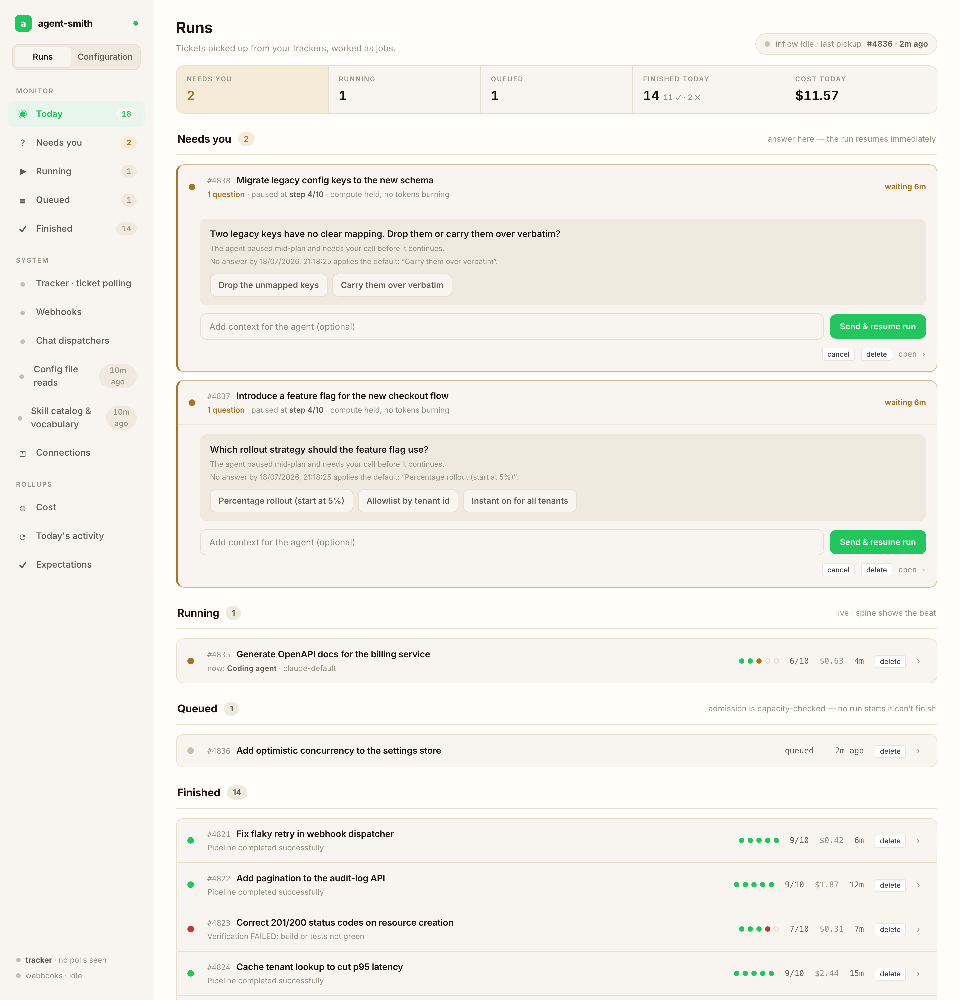
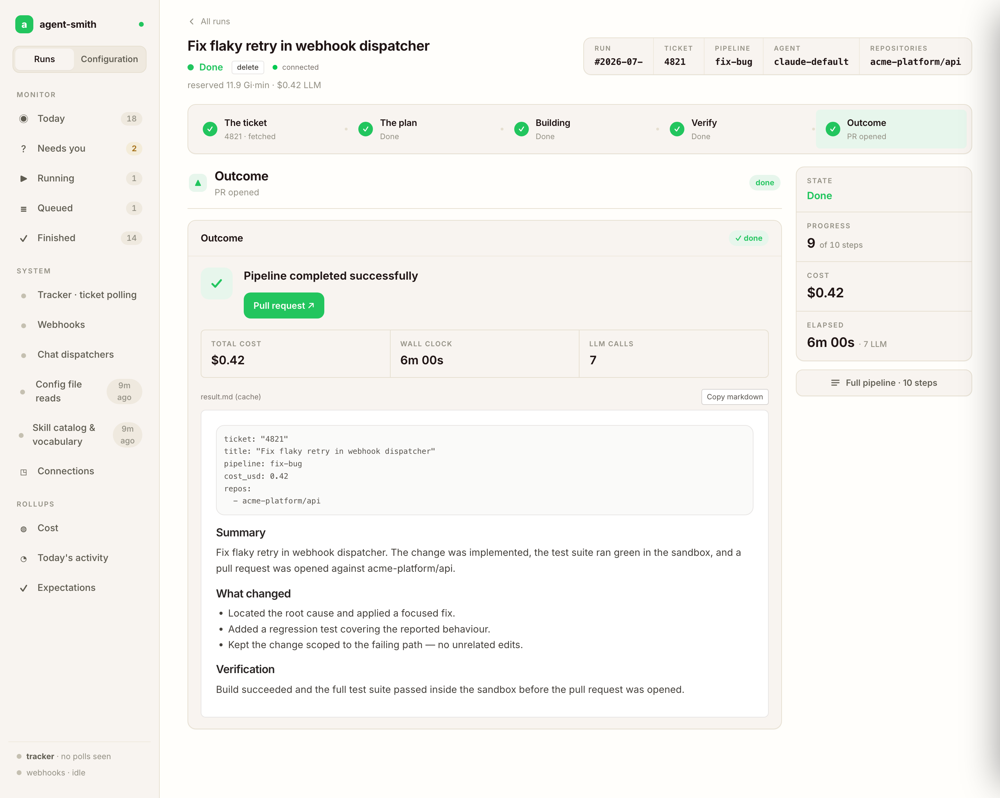
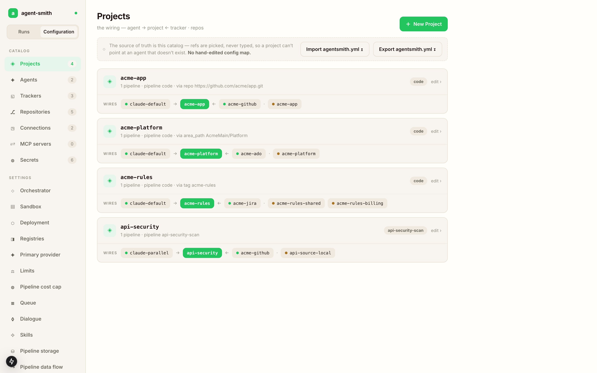

# Dashboard

The web UI for watching what Agent Smith is doing, and, just as important, what it did last Tuesday and what that cost. It reads from the server's database and live event stream. It also writes: it cancels, answers, deletes and initializes runs, and it's where the configuration is edited, because on a server the configuration lives in the database and nowhere else.



## Running it

The dashboard is a Next.js app shipped as its own image (`holgerleichsenring/agentsmith-dashboard`), listening on port 3000.

- With docker-compose it sits behind the `dashboard` profile of `deploy/docker-compose.example.yml`: `docker compose --profile dashboard up -d`, then open `http://localhost:3000`.
- On Kubernetes it's `deploy/k8s/10-deployment-dashboard.yaml` plus `11-service-dashboard.yaml`.

The dashboard proxies `/api/*` and `/hub/*` to the server (`AGENTSMITH_BACKEND_URL`, in compose `http://server:8081`), so the browser stays same-origin. The server's UI API allows loopback callers always and other origins via `AGENTSMITH_DASHBOARD_ORIGIN`.

### Sign-in

Out of the box nobody signs in and nothing is refused. Give the dashboard an OIDC authority and it signs people in itself, with the authorization code flow and PKCE, as a public client. There is no client secret, and there's nowhere to put one.

The settings are environment variables on the dashboard container:

| Variable | What it is |
|---|---|
| `AGENTSMITH_AUTH_AUTHORITY` | The OIDC authority. The same variable the server reads, so one value in a compose `.env` serves both. |
| `AGENTSMITH_AUTH_CLIENT_ID` | The public client registered for the dashboard. Without it, or without an authority, sign-in is off. |
| `AGENTSMITH_AUTH_AUDIENCE` | Sent as an `audience` parameter when set. Also shared with the server. |
| `AGENTSMITH_AUTH_SCOPES` | The scopes requested, space-separated. Defaults to `openid`. |
| `AGENTSMITH_AUTH_REDIRECT_PATH` | Where the authority sends the browser back. Defaults to `/signin-callback`. |

They're not baked into the bundle. The image's entrypoint writes them into `/app/public/runtime-settings.json` when the container starts (override the path with `AGENTSMITH_RUNTIME_SETTINGS_FILE`), so changing one is a restart, not a rebuild. That file is served to any browser that asks, which is fine for an authority and a public client id and is exactly why a secret must never go in there.

Two things only you can set, on the authority's side and in the scopes:

- Register the reply URL (`https://<dashboard>/signin-callback`, or your redirect path) as a single-page application, not as a web application. Otherwise the authority refuses the browser's own token redemption.
- Put `offline_access` in `AGENTSMITH_AUTH_SCOPES`. The session is kept in the tab's session storage and survives a reload, but without a refresh token there's nothing in it that outlives the first access token, usually an hour.

Once the server enforces sign-in, a tab with no session is sent to your organisation's sign-in page once on its own. After that, or when a session expired or its renewal was refused, the page says which of those happened and offers a **Sign in** button, instead of pretending the server is offline. The header shows the account: who is signed in, **Your identity** and **Sign out** behind it.

Two banners watch the pairing between dashboard and server. When only one half has an authority, it says "Sign-in is configured on one side only." When the two name different authorities and a token actually got refused over it, it says "The two halves of sign-in name different authorities." What the server expects is readable without a token at `GET /api/auth/requirements`, which is how the dashboard knows before anyone signs in.

A `401` renders as a sign-in state, a `403` names the permission that was missing. Who holds which permission, the identity page and the server's own `auth:` block are on [Access control](../security/access-control.md).

## The shell

Every route sits under one header and one rail. The header names the place you are on and carries the two things that belong to no single page: a gear that opens configuration in one click, and the account. Where no authority is configured there's no account to show, so nothing is shown.

The rail shows the running system and nothing that is a setting:

- **Work**: **Tickets**, then Needs you, Working, Waiting on review, Stuck, Waits for another ticket, Filed (no run on record), Ended and Done, each with the count the server computed over every ticket. Clicking one filters the ticket list (`/tickets?bucket=`). See [Tickets](#tickets).
- **Monitor**: All runs, Waiting for input, Running, Queued and Finished, each with a live count. Clicking one filters the runs page, and the filter lives in the URL (`?bucket=`), so a filtered view is linkable. Below them, **Pull requests**.
- **Design**: **Work it out**, the design conversation with the agent. It has its own page: [Work it out](../../how-it-works/work-it-out.md).
- **System**: the tracker (named after the tracker it has actually seen polling), webhooks, chat dispatchers, config file reads, and the skill catalog.
- **Insight**: the Overview.

Under `/config` the same rail lists the catalog, the settings, **Permissions**, and a **This installation** group (Installation, Connection check, Changes), plus the way back to runs.

Three banners can appear above every page. A blocking startup finding shows "Running degraded", naming each finding (see [server resilience](server-resilience.md#startup-findings)). A build mismatch between the page and the server shows an advisory banner with a **Reload** button; the server withholds it for the first ten minutes after it starts, because two builds side by side is what a rolling upgrade looks like. And the sign-in banners above.

## Runs

The home page is split into the same buckets as the rail, under a strip of counts (waiting for input, running, queued, finished today, cost today):

- **Waiting for input** lists runs parked on a question. A row opens the run, where the question is answered; a ticket's question is also answered on the ticket list. More on parking in [durable dialogue](../../how-it-works/expectations.md).
- **Running** shows each run's step progress, cost so far and age, and its story beat when the server sends one.
- **Queued** shows each run's place in line (`pos 3`) and the reason it's waiting. A parked run whose answer is in and whose relaunch is waiting for a slot moves here too and reads `resuming · pos 2`, instead of still claiming to need you.
- **Finished** pages back through history with **Load more**. Its header carries **clear finished**, which deletes every finished, failed and cancelled run at once (see [Deleting runs](#deleting-runs)); it shows only while there is a finished run, and not to a signed-in caller without `runs.delete`.

Finished runs say how they ended: done, done with a shortfall (the verified specs shipped and the rest is named as not delivered), failed, or cancelled, each distinct. Every row carries a delete button, which asks for a second click before it acts.

### Run detail



One run reads as a story of five beats, ticket, plan, building, verify and outcome, so you get the arc before the detail. A failed run lights the beat it died in. Clicking a beat switches the stage:

- **The ticket** is the ticket body as fetched.
- **The plan** is the run's `plan.md`.
- **Building** shows the progress ledger, the latest decisions and changes, and a **Specs** panel. Each finished spec opens with its **Decisions**, its steps, and **The spec it executed**.
- **Verify against acceptance** shows the delivery account, one row per acceptance criterion with its disposition, the evidence it cites and the reason. When you think a disposition is wrong you can record your own judgement with a reason. That's a label for later measurement, it doesn't re-open anything. What the account is and how it's built is on [the delivery account](../../how-it-works/delivery-account.md).
- **Outcome** renders `result.md`, with the PRs and the cost, wall-clock and LLM figures.

The rail beside the story is the run at a glance:

- **State**, **Progress** (`x of y steps`) and **Compute**, the pods the run spawned with image and memory. Until the first pod lands it shows "calculating…" and the footprint reserved at admission.
- **Cost**, next to the run's cost cap and budget tier when one was sized, with a bar that turns red at the cap.
- **Shape**, the work shape the run was classified as, with the one-line reason. It's what decided how many specs the ticket was cut into.
- **Started** as an absolute time, **Elapsed** with the number of LLM calls, and while the run works, a live **Sandbox** line with the command count and the last command.
- **Time split**: where the elapsed time went, model, sandbox, scaffolding, and how much of it was spent throttled by the rate limiter.
- The PRs the run opened, one link per repo, or a plain note that none was opened.

Below that, **Full pipeline** opens the step-by-step view. By default it shows the story steps, milestones plus gates that have something to say; internal steps and silent gates fold into one "mechanics" row per segment that expands in place. Nothing is dropped from the data, only from the default view. A running pipeline also lists the steps it hasn't reached yet, marked "The run has not reached this step yet." A step's detail follows it while it runs, shows the newest events first and lets you page back into older ones. Every step carries its LLM cost with model, tokens and the cached share of input tokens. A run whose cached share is 0% has a dead prompt cache, which is an alarm, not a detail (see [cost tracking](../concepts/cost-tracking.md)).

The header of the detail page carries **cancel** and **delete**, both with a confirming second click. Cancel enforces: graceful window, then force-kill, pods released ([cancel semantics](capacity.md#cancel-is-a-state-not-a-wish)). Failures lead with why: a cancelled run says who cancelled it, a timeout names the limit that fired.

### Why this run did that

The live view answers "what is happening". **Why this run did that** (`/jobs/{id}/why`) answers the other question, after the fact. It shows what the ticket cost, broken down by pipeline steps and by sandbox commands with count and duration, then one account per spec: its calls plotted prompt size against answer size, the commands and how they ended, and the calls in full. The recorded conversation can be read from there too.

### Deleting runs

Deleting a run removes it and everything it left behind, including the judgements recorded on its acceptance criteria. A run that hasn't finished is cleared first: its pod is terminated, its lease released, its queue entry dropped, and its ticket disarmed with a comment, so the next poll doesn't pick it up again as a fresh run. A finished run's ticket is left alone, that one's yours to move. If the pod can't be terminated the record is kept and the delete fails with a `502`, so you can retry once the backend answers.

The same over HTTP, both needing `runs.delete`:

```bash
curl -X DELETE https://agentsmith.example.com/api/runs/<runId>
curl -X DELETE "https://agentsmith.example.com/api/runs?state=terminal"   # every finished, failed and cancelled run
```

The bulk form only ever touches terminal runs, so it can't kill a live one. It is what **clear finished** on the runs board calls; its confirming second click says that the finished runs and their verdict history go.

### Retrying after an infrastructure end

`POST /api/runs/{runId}/retry` (needs `runs.control`) starts the same work again, unchanged, and only when the run ended on infrastructure: it was interrupted (no process drove it any more), its replica went away (`stale-lease-reaped`), or a sandbox of its last launch vanished or was OOM-killed. The run must be the ticket's latest attempt and finished. A `202` means the retry is recorded and queued: the rework worker moves the ticket from `failed_status` back to the first trigger status and starts one attempt, whose cause names you with channel `retry`. If the worker can't start it (the tracker offers no move, say), it says so on the ticket, and you can retry again.

Every refusal is a `409` with one body, `{reason, text, project, ticketId}`. `reason` is `not-latest`, `handed-back`, `not-finished`, `not-infrastructure`, `closed-for-work` or `starting`; `text` is the sentence to show. A hand-back and an attempt that ended on its own work are answered in the ticket conversation, where approving a change starts the next attempt; a ticket a person closed in its tracker gets a linked follow-up from an approval there instead of being reopened. A `503` means the tracker couldn't be read, and nothing was recorded.

## Tickets

`/tickets` lists every ticket agent-smith knows about. That is a ticket with at least one code run, where each run is one attempt at it, and a ticket filed from Work it out that has not run yet. It needs `runs.read`. Tickets are grouped by who acts next, under six tiles (needs you with the oldest wait, working, waiting on review with the open pull requests, stuck, done this month with attempts per ticket, and this month's spend). Every ticket sits in exactly one section:

- **Needs you**: the newest attempt is parked. A question is answered in place, and **Send & resume attempt n** resumes that attempt. A hand-back shows the words it posted and leads into the ticket's conversation in Work it out, because there is no paused run to resume.
- **Working**: an attempt is running or waits for capacity.
- **Waiting on review**: a pull request is open and a person owns the next move. The row names the review decision and who made it, and says when a request for changes came from someone who is not a trusted reviewer.
- **Stuck**: the last attempt failed and a check saw the ticket unchanged and untouched since.
- **Waits for another ticket**: filed, no run on record, and a ticket it requires has not landed yet (merged, or marked done by hand). How requires are filed and when a held ticket starts is on [Ticket dependencies](../../how-it-works/ticket-dependencies.md).
- **Filed, no run on record**: filed, nothing it requires is still open, and no run has been recorded.
- **Ended**: no next step is running or waiting, such as a cancelled attempt, a success without a pull request, or pull requests that were all closed unmerged. The dot follows how the last attempt ended, except that pull requests all closed unmerged draw it red.
- **Done**: a pull request merged and every other one ended (merged or closed), or a person marked the ticket done by hand. Collapsed to this month's count until **Show done**. Pull requests that were all closed unmerged are not done.

Each row shows the series strip (one cell per spec of the current series, then one per pull request), a mark per attempt, the summed cost and the age, and opens the ticket's page. A section holding more tickets than the page loaded ends with **Show all**, which opens its bucket view. On the runs home, a code run of a ticket opens the same page; any other run opens its run viewer.

### The graph view

The **List | Graph** switch at the top of `/tickets` draws every ticket that requires another or is required by one, with an arrow from each ticket to what it requires. The view lives in the URL (`/tickets?view=graph`), so you can link to it. Each node carries the tracker key, the title and its state: merged or done by hand, running, blocked, ready, or "no run · no page". A node with a ticket page opens it. A node without one (a ticket someone wrote by hand in the tracker and named as a requirement, say) opens a small panel with what requires it and the **Mark done by hand** act. When no ticket requires another yet, the view says so. The same graph is `GET /api/tickets/graph` (optionally `?project=`), with `runs.read`.

### Marking a ticket done by hand

Sometimes a required ticket is finished without a merge agent-smith could see: shipped by hand, solved elsewhere, dropped on purpose. **Mark done by hand** counts it as landed. The dialog asks for a note (it's required: why does this ticket count as landed?) and says what follows, namely that the tickets waiting for it stop waiting, and that it can't be undone. The act needs `runs.control`, because a landing can start every ticket that waited for it. It appears on a ticket page's header, beside each unlanded entry under **Waits for**, and on a page-less graph node, and is hidden from a caller known to lack the permission and on a ticket that already landed.

Over HTTP it is `POST /api/tickets/{project}/{ticketId}/landed-by-hand` with `{"note": "…"}`. The tracker has to know the ticket before anything is recorded. Every refusal is a plain sentence: a missing note (`400`), an unknown project or ticket (`404`), a ticket that already landed, with who marked it and when or when it merged (`409`), or a tracker that could not be read (`503`, nothing recorded).

### A ticket's page

`/tickets/{project}/{ticketId}` opens on **Summary**. The header names the ticket, links its tracker, says which tracker status the newest attempt read, which attempt is running (or how the newest ended), how its pull requests ended (such as "1 PR merged, 1 open" or "3 PRs closed unmerged") and the work branch; its dot is the list row's dot. **Cancel attempt n** ends a running attempt, and **Mark done by hand** (see [above](#marking-a-ticket-done-by-hand)) sits beside it until the ticket has landed.

Between the header and the tabs, two things can show up. The series strip appears when the ticket's series holds more specs than one attempt runs, or attempts have already chained (described [below](#the-series-strip)). **Waits for** lists the tickets this one requires, each by its tracker key with "(not merged)", "(merged)" or "(done by hand)" and, for a landing by hand, who marked it, when and their note. Each one still open carries its own **Mark done by hand**. **Required by** lists the tickets waiting for this one, with their state. An entry that has a page here links to it.

A ticket that was filed but never ran has no attempts, so nothing to show in tabs. Its page is the header, Waits for and Required by, and one line, "Filed, no run on record", with a link to settle its specs first in Work it out.

The Summary tab starts with the ticket itself, as its tracker has it now: the work item type, the state ("now: Active"), labels, the assignee, the description (twelve lines, then **Show all**) and the tracker's own acceptance criteria, labelled "Acceptance criteria (from the ticket)" so you don't confuse them with the specs' done criteria on the Acceptance tab. When the tracker can't be read, the panel shows the copy the last attempt read, with which attempt and when, or says why the tracker refused (not found, credentials refused, no answer, project no longer configured). The same read is `GET /api/tickets/{project}/{ticketId}/text`.

Four cells then describe the chosen attempt: what started it, its series revision with how many specs it carried and how many it cut new, the ticket's pull requests with their review state, and its wall time, cost and repositories. A banner names the specs an attempt carried from earlier attempts at no cost.

Below is the attempt's flow graph, one tab per attempt: ticket, derive (with a count of the cuts the reviewer refused), then either the hand-back or the spec gate, one row per spec of that attempt's cut, and the ship or end node. A carried spec is one small dashed node. A spec that ran gets build and verify, one lane per master pass, numbered within the spec, with the reason the master went back on the return edge; **folded** shows only the last pass. A question hangs off the build of the pass that parked. Choosing a node, by click or Enter, explains it from that attempt's own records below the graph; a node with nothing recorded says so. An attempt from before attempts recorded their cut has no graph and links to its run viewer. The page follows a running attempt without a reload.

**Conversation** holds every exchange about the ticket in order: its comments and text edits, the run questions and their answers, pull-request reviews, the spec cut's reviews and hand-backs, and the ticket's own Work it out conversation, grouped under the attempt they belong to. Chips filter by source, an entry a person wrote carries their name, and an entry that started an attempt says so. A waiting run question heads the tab. Below the thread, **Continue on this ticket** is that Work it out conversation. While the agent works on a reply there, the composer shows what it is doing: the files and searches it reads, the steps so far and the time elapsed. The waiting line ends once the reply is recorded, even when the live push of that reply was lost; the next read of the conversation shows it. Opening the tab changes nothing; the first thing you do there (focus the field, send, approve, discard) reopens the ticket's conversation, on its own dialog, so your Work it out conversation stays where you left it. With a proposal open, the line above the buttons says what approving does: continue the series, file a follow-up for a closed ticket, and when the next attempt starts. **Retry unchanged** appears after an attempt ended on infrastructure. Without `dialog.write` on an installation that enforces it, the ticket's own conversation is not shown. The header's **Continue in conversation** opens this tab.

**Specs** shows the series as read-only documents: per spec a cell for every attempt (not run, done in n passes, carried, failed, working, not started), and for the selected spec its goal, steps as worked with the attempt and pass that completed each, and its done criteria. A spec that ran also shows its build note, what its master renamed, moved, persisted or deviated from, which is what the next spec starts with ("no note" when it left none). Below that come the spec's review rounds from before it was built: per attempt, and the rounds the approved set went through in the design conversation, each with its merged verdict (build, build with cuts, refuse), its reviewers, every cut as the quoted text and its replacement with the evidence, the wording still standing, and the revision it produced. When the set itself was reviewed, a **Series contract review** section sits between the spec grid and the revisions, with the findings and the cuts naming the member they touch; clicking a member opens that spec. Then the revisions. The reviews are one read, `GET /api/tickets/{project}/{ticketId}/reviews`. A spec changes only through the conversation. **Acceptance** lists each spec's done criteria with the attempt that verified them; an operator's overrule shows beside the verdict.

**Attempts** lists every attempt, newest first: what started it (the channel, such as a ticket comment, a pull request, a retry, an overruled default, or "series, started automatically" for one the series started itself; who, where, how many specs it carried, the questions it asked and how long they waited), its wall time, cost and specs done — or, for the running attempt, the spec and step it is on, or *deriving* until its own cut exists. Opening a card shows what the attempt did (each cut with the reviewer's verdict, the pull requests it opened, each spec's outcome with its passes, questions and resumes) and why it ended (finished, failed with the failing spec's last pass reason, handed back with its case, cancelled), with links to the run viewer and to its trace. Between two cards stands the change that started the newer one; **read** opens the Conversation tab at that entry. Apart from the starts the series makes by itself ([the series strip](#the-series-strip)), the next attempt starts from the conversation.

**Cost & compute** draws one bar per attempt on one scale — the largest run cap, or the largest cost where no attempt has a cap — split into derive, each spec with its passes, pull requests, other and not attributed; a run whose own cap is smaller has it marked on its row, and carried specs are written at $0. Below, pod time, memory reserved (the run detail's reservation, finished attempts only), model call time (summed call durations, which overlap when sub-agents run in parallel) and time waiting on you (question and hand-back parks only; a wait for capacity is shown apart). A pod no close event reached is counted to the end of its launch; the tile names the run detail's figure, which counts it to the run's end. When waiting on you took longer than all model work, a banner names each wait. Per attempt a wall-clock bar shows each launch, the parks and capacity waits between them, and the pods with how each ended. The pods behind one run, with their times and how each sandbox ended, are `GET /api/runs/{runId}/compute`.

**Defaults** holds the choices a master took on its own while it worked, the ones no person had to make before work could go on, and the feedback memories it proposed. Each row says where it was taken (an attempt, or the design conversation), the spec, what was asked, what was chosen, instead of what, and why; a memory proposal shows the path of its file. Pending ones come first. A default marked as holding the series is drawn in the waits-for-a-person colour, because the series doesn't start its next attempt by itself while it waits (the other pending ones never hold anything). Tick one or **Select all**, then **Ratify selected** or **Overrule selected**, with one note for every overrule of that act. An overrule starts the next attempt, whose cause reads "overruled default" and which derives again with your note. A default from the design conversation can only be ratified here; you overrule it in that conversation. Deciding needs `runs.control`, reading `runs.read`. Decided defaults follow below with who decided, when, and the note. The tab's counter shows the pending ones, in the hot colour when one of them holds the series.

### The series strip

A series holds at most `series.max_specs` specs (24 by default), and one attempt runs at most `series.specs_per_attempt` of them (8 by default, and only as many as fit the run's wall clock). A series that doesn't fit in one attempt goes on attempt by attempt; the specs left over wait, not started, for the next one. When an attempt ends with specs left and nobody's act is pending, agent-smith starts the next attempt itself, inside a budget for the whole chain of attempts: `series.budget_usd` (default $150) and `series.wall_clock_hours` of summed run time (default 12). Time spent waiting between attempts doesn't count. An attempt the run's wall clock cancelled after it finished a spec counts as having ended at a spec boundary and continues too, unless `series.continue_after_wall_time` is off. The chain starts at the newest attempt a person or a trigger started. A `series.budget_usd` of 0 turns automatic continuation off. The values live in Settings → Series ([Global settings](../../configure-it/settings.md)).

The strip between the header and the tabs shows that runway: the chain's spend against the budget and its run time against the cap, each with a bar that turns hot at the cap; the chained attempts (`A2 → auto A3`, an automatic start marked "auto"); and what happens next: "the next attempt starts by itself", "the series is complete", or "held" with the reason. A series holds when the last attempt handed back, was cancelled, ended without finishing or finished no spec, when the budget or the run time is used up, when a default that holds the series waits for a person, when the last automatic start was refused, when a person closed the ticket, or when the series settings are invalid. The way on is named with the reason: a comment on the ticket or an approval in its conversation starts the next attempt; a holding default links to the Defaults tab; invalid settings link to Settings → Series. A hold that agent-smith causes itself (no progress, budget, run time, a holding default, invalid settings) is also said once on the ticket, with spend, run hours and the specs left. A series that fits in one attempt, or one with continuation turned off, has no strip.

## Pull requests

**Pull requests** in the rail lists what the agent shipped: open today, this week and in total, then every opened PR with a link out to the provider and back to its run. Underneath, **No PR** lists the runs that produced no pull request, and why.

## Overview

**Insight → Overview** is the reading of the system rather than a part of it. Three cards over two panels:

- **Spend · 7 days**, today and the trailing week with the LLM calls behind it. The panel **Where the money went** breaks the week down by repo and pipeline. Every figure is grouped from the run list the dashboard already holds; there's no separate cost endpoint and no second truth.
- **Runs**, the same buckets the rail counts, with the finished ones split into succeeded, failed and cancelled.
- **Criteria met**, the share of acceptance criteria that finished `code` runs met: met over met, unmet and unproven, with not-applicable criteria counted on neither side. The panel **Criteria outcomes** breaks it down per project and per month of the run's finish (UTC). An operator's overrule of a criterion counts while the status it answered is still the run's; once the run has been judged differently it is shown as stale and not applied. Runs of other pipelines are not counted, and a share never renders as 0% without a measurement.

## System

The System entries answer "is this thing alive and why didn't my ticket trigger":

- Per subsystem (tracker polling, webhooks, chat dispatchers, config reads) a status with live/idle freshness and a live event tail.
- The trigger log: every received webhook and poll cycle with its verdict, actioned, or skipped with the reason (no matching project, no trigger label, signature invalid).

Each subsystem has its own address under `/system/…`, so a selected one survives a reload and can be linked. A few older addresses still work and lead to where their content lives now: `/system/today`, `/system/cost` and `/system/expectations` open the [Overview](#overview), `/system/installation` opens `/config/installation`, and `/system/connections` opens `/config/connection-check`.

## This installation

**Installation** (`/config/installation`) says which build of Agent Smith this installation runs: the server's release and revision, the dashboard's, and the sandbox agent's per project (or "not stated by this build" when a locally built image carries no stamp). Below that the skill catalog the server is **Bound to** and, labelled separately, the **Embedded floor** the binary was built against. Then the database: provider, and whether migrations are pending, with the command that applies them. The report behind the page, `GET /api/config/installation`, answers without a token, because which build is running is the question you ask when nothing else answers. The same page takes and restores [data archives](data-archive.md).

**Connection check** is the runtime diagnostics page: every configured connection (trackers, repo connections, LLM agents, sandbox backend, Redis, database, chat adapters) with a probe button per row and a "Test all". A probe is the cheapest authenticated call against the real dependency, so a red row is a real problem, named. Webhooks get a "secret configured / last delivery seen" panel instead of a probe button, since the server can't actively probe an inbound webhook. The same probes back `agent-smith doctor` and the server's startup preflight on `/health`.

**Changes** is the audit trail of every configuration change.

## Configuration studio



On a server, the database is the store of record for configuration, and this is where you edit it. Reached from the header's gear, **Configuration** is a relational catalog (projects, agents, trackers, repositories, connections, MCP servers, [design sources](../../configure-it/design-sources.md), secrets) that you create and edit in place. Refs are picked, never typed: a project points at its agent, tracker and repos by choosing them from the catalog, so it can't reference an agent that doesn't exist, and a connection-scoped repo ref either resolves or is flagged. Changes apply while the server runs.

**Import agentsmith.yml** and **Export agentsmith.yml** move the catalog in and out of the file format the CLI reads. Secrets are referenced by name, never shown. The whole picture, including what a server still reads from the file, is on [Where configuration lives](../../configure-it/index.md) and [the Config studio](../../configure-it/config-studio.md).

## Catalog

The Catalog view shows the loaded skills catalog: every skill and master with its rendered SKILL.md, the concept vocabulary with types and definitions, and where the catalog came from. The origin line points at the setting that decides it, Settings → Skills, and says when an overlay directory on the server is layered over the source, since no setting in the dashboard changes that one. A saved change to the source shows up once the server resolves the catalog again, which the next pipeline run does. The run detail's "Load catalog" step shows the same for a specific run.

## Next

- [Capacity & queueing](capacity.md): what a queued run is waiting for and how to size the knobs.
- [Server resilience](server-resilience.md): `/health`, startup findings and the degraded banner.
- [Access control](../security/access-control.md): sign-in, roles and permissions.
- [Cost tracking](../concepts/cost-tracking.md): the numbers behind the cost columns.
