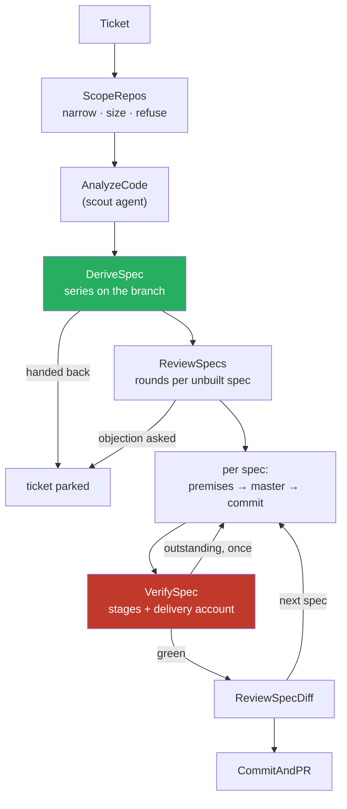

# The code pipeline

The **code** pipeline is Agent Smith's coding workflow. It takes a ticket, reads the codebase, derives a specification, works it spec by spec, verifies each spec, and opens a pull request per repository.

Bugs, features, refactors and migrations all run through it. The ticket's label is an input to the specification rather than a choice of pipeline. The names `fix-bug`, `fix-no-test`, `add-feature` and `phase-execution` no longer resolve: a server rewrites a stored configuration that still names them to `code` once at startup and says so, while a CLI `agentsmith.yml` carrying one fails until you edit it to `code`.

## Pipeline steps

| # | Command | What it does |
|---|---------|-------------|
| 1 | LoadCatalog / PipelineNameInitializer | Loads the pinned skills catalog, names the run |
| 2 | FetchTicket | Reads the ticket, its comments and attachments from GitHub / Azure DevOps / Jira / GitLab |
| 3 | ScopeRepos | Narrows the run to the repos the ticket affects, estimates its size, refuses what must not be done |
| 4 | CheckoutSource | Clones each repo, creates the work branch `agent-smith/<ticket-id>` |
| 5 | RunPreflight | Proves the run's preconditions before anything is spent on them |
| 6 | SetupRegistryAuth | Pre-stages private-feed credentials in the sandboxes |
| 7 | BootstrapCheck / BootstrapGate | Refuses a repo with no `.agentsmith/` context |
| 8 | LoadCodingPrinciples / LoadMemoryIndex / LoadDesignSystem / LoadContext | Loads the repo's principles, memory index, root DESIGN.md and context |
| 9 | AnalyzeCode | Scout agent maps the relevant code |
| 10 | DeriveSpec | Turns the ticket into an ordered series of specs on the ticket branch |
| 11 | SpecHandback | Parks the ticket when the derivation handed it back |
| 12 | ReviewSpecs | Fresh reviewers attack every unbuilt spec, round by round, before the master builds it |
| 13 | SpecGate | Validates the spec before a single master token is spent |
| 14 | EnsurePrerequisites / ProbeTarget / MaterializeReferenceSets | Installs what the work needs, checks the target answers, and writes the uploaded sets and images the approval cites |
| 15 | SpecSequence | Splices one block of steps per spec this attempt builds |
| 16 | WriteRunResult | Writes `result.md` with the account, token usage and cost |
| 17 | CommitAndPR / PrCrossLink | Commits, pushes, finalizes the PRs and cross-links them |

`RunPreflight` fails the run, naming the fix, when the agent configuration is the empty placeholder, when a sandbox home isn't writable, or when a declared credential is malformed or didn't arrive. A branch that already carries earlier work, or a registry whose secret resolved to nothing, is reported without stopping the run.

`ProbeTarget` runs the `probe` command a repository declares, after the prerequisites are installed and before the master starts, so a target that refuses costs no model token. Both come from the [context file](../concepts/context-file.md).

`MaterializeReferenceSets` writes every website set the approval cites into the repository of the series' earliest spec, at `.agentsmith/reference/<setId>/`. The directory is excluded from the commit and from whole-repository searches; the master's prompt names each set. A cited set the run cannot read fails the run, naming it. The images the approval cites travel the same way, to `.agentsmith/reference/images/<setId>.<ext>`, also outside the commit, and are shown to the master's model as images. An image the run can't read leaves a line in the prompt and the run goes on, since the master builds against a set but is only shown an image. A master that carries uploaded sets also gets `view_reference_image` for the images inside them, browser or not. A project whose `sandbox.browser.enabled` is on also gives the coding master `render_reference` and `compare_reference` and reserves one browser pod per run. `compare_reference` lists every computed-style difference between mapped selectors of a reference and a candidate page and a screenshot similarity; the run's comparisons appear in `result.md` under *Visual comparison*, with up to four diff images under the run record. They report and never gate.

### The per-spec block

`SpecSequence` expands into this block for every spec the attempt builds, in order:

| Command | What it does |
|---------|-------------|
| SelectSpec | Makes the spec current; a spec the branch already satisfies is recorded done and its work steps are skipped |
| CheckSpecPremises | A fresh instance checks what the spec says it rests on; a false premise hands the spec back |
| AgenticMaster | The coding master does the spec's work |
| MasterOpenQuestions | Parks the run when the master asked a person something |
| CommitSpecWork | Runs the declared formatter, judges the structure limits, and puts the spec's work on the branch before it is judged |
| VerifySpec | Runs the declared verify stages, then takes the delivery account |
| ReviewSpecDiff | A fresh reviewer reads the spec diff; findings get one fix pass |
| WriteSpecRecord | Moves the spec to `.agentsmith/specs/done/` with its outcome and build note |



A red spec stops the sequence; the remaining specs don't run, and delivery decides between a failure and a shortfall (see [Lifecycle](../../how-it-works/lifecycle.md#when-it-goes-wrong)).

Before `VerifySpec` runs a stage, every sandbox of one repository is brought to the union of the work done in them. A repository with two toolchains has two sandboxes; when both changed the same file differently, verify is red and names the file.

## The specification

`DeriveSpec` cuts the ticket into a **series**: an ordered set of specs that share one base id. The base is minted in code, once, from the clock: today's UTC date plus four random hex digits, such as `2026-10-15-3f2a`. Each spec is the base plus a letter, `2026-10-15-3f2aa`, `2026-10-15-3f2ab`, and a re-run reads the base back from the branch instead of minting a new one. On the ticket branch the series lies as:

```
.agentsmith/
├── series/
│   └── 2026-10-15-3f2a.yaml                         # the manifest
└── specs/
    ├── planned/
    │   ├── 2026-10-15-3f2ab-todo-empty-list.yaml     # spec not built yet
    │   └── 2026-10-15-3f2ab-todo-empty-list.md       # its Markdown companion
    └── done/
        ├── 2026-10-15-3f2aa-todo-repository-query.yaml   # executed, with an outcome block
        └── 2026-10-15-3f2aa-todo-repository-query.md
```

Per spec there is a schema-valid YAML file and a Markdown companion with the verbatim parts of the ticket it carries. The manifest at `.agentsmith/series/{base}.yaml` is what the next run reads: the ticket it belongs to, the goal, the ordered spec ids, the revisions, the accounting (which spec carries each part of the ticket, or why a part was discarded), a hand-back if there was one, the approval when a person approved the series, and the series contract. A spec's directory is its state. When a spec has run, `WriteSpecRecord` moves it and its companion from `planned/` to `done/` and appends an `outcome:` block: the run that executed it, what it delivered, what the spec review still finds, and the build note under `hand_forward`.

A fresh cut holds at most `series.specs_per_attempt` specs (default 8). A series may grow to `series.max_specs` (default 24) through later re-cuts and additions; one attempt builds at most `series.specs_per_attempt` of them, fewer when the run's wall clock left does not fit that many, and the rest wait for the next attempt.

Before it writes, the derivation may look at the repositories through read-only tools. A cut that fails validation goes back to the model with the reason, up to three attempts; a fresh reviewer objects to cuts it doesn't accept, and if every attempt drew an objection the least-objected cut is kept and the objection is shown on the run. The cut reviewer also reports a spec that drops an outcome the ticket's own "Done when" list states. A cut that covers fewer of the contexts the scope call named gets one more attempt; a gap that survives it becomes a question for the author. If nothing usable comes back from a one-repository scope, the whole ticket runs as one spec and the run says why; over several repositories the ticket is handed back instead (see below).

In a multi-repository scope every spec names exactly one repository. Work in two repositories is cut as two specs. How the series is then split across the repositories is on [Multi-repo](../../how-it-works/multi-repo.md#one-series-across-repositories).

The series is committed, a draft spec PR opens in every repository the series touches, and the cut is posted to the ticket with its criteria, facts and assumptions. The run doesn't wait on it. How you correct a cut, and how an approved specification from a design conversation is handled, is on [Expectations](../../how-it-works/expectations.md#the-done-list-is-the-expectation).

### The series contract

A series with several specs may carry a contract in its manifest: the names its members declare and the numbers those take (an event, a table, an endpoint, a config key, a tool and so on, from a fixed list of kinds), the data each member owns, the files each member touches, and a per-member line budget for a file several of them share. Every entry names its owner by spec id. Each thing has one owner, a number is taken once per kind, and a file several members touch needs a budget from each of them. A contract that collides goes back to the model with every collision named; if the last attempt still collides, the cut is kept without a contract.

The contract is read twice more. After the per-spec review below, one fresh reviewer checks the whole set of cleared specs against it. After a spec is built, the diff reviewer flags a change that breaks it.

### Build notes

Each spec's master ends by handing a build note to the next spec through the `hand_forward` tool: what it renamed, what it moved, what it persisted, and where it deviated from the spec. The note is stored in the spec's outcome block, the next spec's master and premise check read it, and the ticket page shows it. When the next spec is entered, its `path:line` citations that point at moved code are re-grounded, and that shows on the ticket as a revision of the set; a build note that contradicts the series contract is flagged. The master's prompt also carries the memory index read fresh at that point, so a fact an earlier spec remembered reaches the next one.

## The spec review before building

`ReviewSpecs` runs after the cut and before any master token is spent. Every spec this attempt would build is attacked, in order, unless its text is still exactly what a person approved in [Work it out](../../how-it-works/work-it-out.md). An approved spec that the run had to revise is reviewed like any other.

A round goes like this. The spec's cited evidence is checked first: each `path:line` it cites has to exist. Then `spec_review.reviewers` fresh reviewers (default 2, `spec_review.max_concurrent` at once) open the code and answer **BUILD**, **BUILD WITH CUTS** or **REFUSE**, each finding with the `file:line` it rests on. Their answers are merged. Cuts are applied by a fresh reviser that may change only the text a cut names; whatever a cut asked for and the revised text still carries is a residue the next round is shown. A revised spec is published to the branch as a new revision of the set, and its evidence is checked again.

The rounds stop when the merged verdict is BUILD, or BUILD WITH CUTS with every cut applied and no broken citation left; when a round changed no text; or when `spec_review.rounds` (default 4) are used up. A REFUSE without cuts gets the spec rewritten once from the code and a fresh round; a second REFUSE stands.

The review lives on a share of the run: `spec_review.budget_share_percent` (default 40) of the cost cap and of the run's wall clock, counting everything the run spent so far, derivation included. The first spec is always reviewed; the share is checked before every spec after it. When the share is used up, the first spec not yet cleared and every spec after it are left to the next attempt, and the run builds what was cleared. `spec_review.rounds: 0` turns the review off. The four values are global settings, edited under **Spec review** in [Settings](../../configure-it/settings.md) or in `agentsmith.yml`.

A REFUSE that still stands after the rounds becomes one question to the author. The specs before it are built first; then the ticket parks at the refused spec with a comment headed "an objection from the spec review stands", the readings it sees, and the one the next run will take. When the refused spec is the first unbuilt one, the ticket parks before anything is built. Each objection is asked once: the next run proceeds on the named reading, answered or not, and an answer is read by the next derivation.

Every round, every reviewer's verdict and every cut shows on the ticket page under **Specs**.

## When the ticket comes back to you

The derivation hands a ticket back instead of guessing. Each case comments on the ticket and parks it:

- **Two readings.** The comment lists both and names the one the run would take. Answer and move the ticket back to a trigger status; if the ticket comes back with nobody having answered, the run proceeds on the named reading and says so.
- **Contradicts the repository.** Before it parks, a fresh checker with no stake in the claim reads the evidence the contradiction cites. When it refutes the claim, the derivation gets one more attempt with the refutation. A confirmed contradiction parks in `needs_clarification_status`. A second contradiction with no reply on the ticket in between ends the run as a failed step: "the loop ends here".
- **Not implementable as specified.** Parks in `not_implementable_status` when you configured one, otherwise in `needs_clarification_status`. It doesn't restart on a comment; answer it in the ticket's conversation, where approving a change starts the next attempt. Retry repeats an attempt unchanged and only after an infrastructure end, so it refuses a hand-back.
- **The work could not be divided between the repositories.** In a multi-repository scope, no cut named exactly one repository per spec. Nothing was derived. Reply with the repository each part belongs to, or split the ticket per repository, and move it back to a trigger status; the next run cuts again.
- **The series is out of step between its repositories.** The repositories carry different revisions of the series, and the comment names the ones that lag. Nothing runs on a mix. Either write a comment whose first line is `cut this specification again` and move the ticket back to a trigger status, which cuts the series again over every repository and keeps the specs that already ran, or approve the specification again in the design conversation and file the ticket again.
- **The approved specification is not on the branch.** A ticket filed from an approval whose series can't be read on its branch. Put the specification on the ticket branch and move the ticket back to a trigger status.
- **Refused.** Raised by `ScopeRepos` before checkout, with the offending sentence quoted. If the request is legitimate, reply with why and move the ticket back; the next run reads your reply beside the ticket.

A standing objection from the spec review parks the ticket the same way, described above. When no park status can be resolved, the run fails rather than leave the ticket claimable.

## The structure gate

`CommitSpecWork` does two things before the spec's work reaches the branch. It runs the formatter a context declares (`format` in the [context file](../concepts/context-file.md#format-is-the-repositorys-own-formatter)) over the files the spec changed. A formatter that fails is named at the top of that repository's code PR, with its command, exit code and output; the files are committed as written. Then it judges every changed file against the size limits in its context's principles, minus what the context's baseline already tolerates. A unit past the tolerance band goes back to the master for one correction pass ahead of `VerifySpec`; a second one fails the spec. The whole mechanism is on [Structure limits](../../how-it-works/structure-limits.md).

## The coding master

`AgenticMaster` runs the `coding-agent-master` skill in an agentic loop: it calls tools, observes the results, and decides what to do next. Its file tools (`read_file`, `write_file`, `edit`, `multi_edit`, `grep_in_tree`, `find_files`, `list_directory`, …) and `run_command` dispatch to the right sandbox by the first path segment, so one conversation works across all repos in scope. Besides those it has `update_progress` for its progress ledger, `ask_human` for a question that parks the run, `log_decision`, `hand_forward` for the build note, and `ensure_repo_sandbox` for a repo it didn't start with.

A master may stop on its own word: the build stays red with nothing left on its ledger, it names a blocker, or it declares the open criteria not applicable. When it does that while a criterion of the spec is not met and budget is left, it gets one more pass with its own reasons put in front of it. A stop it repeats after that is respected. The run records which kind of stop ended the loop.

The master runs the repo's build and tests itself as it works; `VerifySpec` then runs the declared stages again as the gate, and the [delivery account](../../how-it-works/delivery-account.md) judges the criteria. Long sessions are kept inside the model's window by compaction; see [Context compaction](../concepts/context-compaction.md).

!!! info "Tool execution"
    All tools run in the cloned repository's working directory. File paths are relative to the repo root. Shell commands execute with the repo root as the current directory.

## Running

```bash
# Work a ticket
agent-smith code --ticket 54 --project todolist

# No interactive prompts (what CI and cron want)
agent-smith code --ticket 54 --project todolist --headless

# Dry run -- print the pipeline steps without executing
agent-smith code --ticket 54 --project todolist --dry-run
```

`agent-smith fix` and `agent-smith feature` still work as aliases; they print a deprecation notice and run `code`. All options are on [Trigger: CLI](../../trigger-it/cli.md).

## Output

- The work branch `agent-smith/<ticket-id>` in every repo in scope, carrying the series, the checkpoint commits, the change and the executed specs under `.agentsmith/specs/done/`.
- One **pull request** per repository the series touches, opened as a draft at the spec commit, cross-linked with the others, and taken out of draft only by a complete, verified run. A repository whose specs gained no code keeps its spec PR as one of the run's PRs. The body carries the ticket, the per-spec table, the delivery account, what the spec review still finds, declined criteria, the structure divergences inside the tolerance band, and a formatter that failed. A red run's PR stays a draft with a banner.
- A **run record** in `.agentsmith/runs/<run-id>/` with `result.md`, plus the master's `plan.md` where it wrote one.
- The **ticket** gets a comment with the PR links, your done status and the `agent-smith:done` label — or `agent-smith:shortfall` / `agent-smith:failed` when the run fell short.
