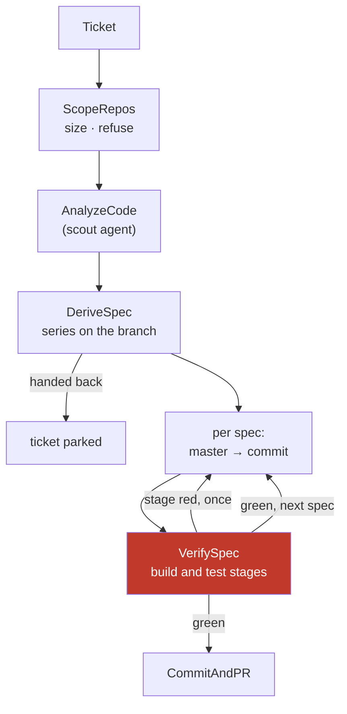

# The code pipeline

The **code** pipeline is codeably's coding workflow. It takes a ticket, reads the codebase, derives a specification, works it spec by spec, verifies each spec, and opens a pull request per repository.

Bugs, features, refactors and migrations all run through it. The ticket's label is an input to the specification rather than a choice of pipeline. The names `fix-bug`, `fix-no-test`, `add-feature` and `phase-execution` no longer resolve: a server rewrites a stored configuration that still names them to `code` once at startup and says so, while a CLI `agentsmith.yml` carrying one fails until you edit it to `code`.

## Pipeline steps

| # | Command | What it does |
|---|---------|-------------|
| 1 | LoadCatalog / PipelineNameInitializer | Loads the pinned skills catalog, names the run |
| 2 | FetchTicket | Reads the ticket, its comments and attachments from GitHub / Azure DevOps / Jira / GitLab |
| 3 | ScopeRepos | Estimates the ticket's size and shape and refuses what must not be done; does not narrow the run's repos |
| 4 | CheckoutSource | Clones each repo, creates the work branch `agent-smith/<ticket-id>` |
| 5 | RunPreflight | Proves the run's preconditions before anything is spent on them |
| 6 | SetupRegistryAuth | Pre-stages private-feed credentials in the sandboxes |
| 7 | BootstrapCheck / BootstrapGate | Refuses a repo with no `.agentsmith/` context |
| 8 | LoadCodingPrinciples / LoadMemoryIndex / LoadDesignSystem / LoadContext | Loads the repo's principles, memory index, root DESIGN.md and context |
| 9 | AnalyzeCode | Scout agent maps the relevant code |
| 10 | DeriveSpec | Reads the series on the ticket branch; a ticket without one gets a stand-in spec per repository (no model) |
| 11 | SpecHandback | Parks the ticket when the series cannot be worked (out of step, approved set missing) |
| 12 | SpecGate | Validates the spec before a single master token is spent |
| 13 | EnsurePrerequisites / ProbeTarget / MaterializeReferenceSets | Installs what the work needs, checks the target answers, and writes the uploaded sets and images the approval cites |
| 14 | SpecSequence | Splices one block of steps per spec this attempt builds |
| 15 | WriteRunResult | Writes `result.md` with the account, token usage and cost |
| 16 | CommitAndPR / PrCrossLink | Commits, pushes, finalizes the PRs and cross-links them |

`RunPreflight` fails the run, naming the fix, when the agent configuration is the empty placeholder, when a sandbox home isn't writable, or when a declared credential is malformed or didn't arrive. A branch that already carries earlier work, or a registry whose secret resolved to nothing, is reported without stopping the run.

`ProbeTarget` runs the `probe` command a repository declares, after the prerequisites are installed and before the master starts, so a target that refuses costs no model token. Both come from the [context file](../concepts/context-file.md).

`MaterializeReferenceSets` writes every website set the approval cites into the repository of the series' earliest spec, at `.agentsmith/reference/<setId>/`. The directory is excluded from the commit and from whole-repository searches; the master's prompt names each set. A cited set the run cannot read fails the run, naming it. The images the approval cites travel the same way, to `.agentsmith/reference/images/<setId>.<ext>`, also outside the commit, and are shown to the master's model as images. An image the run can't read leaves a line in the prompt and the run goes on, since the master builds against a set but is only shown an image. A master that carries uploaded sets also gets `view_reference_image` for the images inside them, browser or not. A project whose `sandbox.browser.enabled` is on also gives the coding master `render_reference` and `compare_reference` and reserves one browser pod per run. `compare_reference` lists every computed-style difference between mapped selectors of a reference and a candidate page and a screenshot similarity; the run's comparisons appear in `result.md` under *Visual comparison*, with up to four diff images under the run record. They report and never gate.

### The per-spec block

`SpecSequence` expands into this block for every spec the attempt builds, in order:

| Command | What it does |
|---------|-------------|
| SelectSpec | Makes the spec current; a spec the branch already satisfies is recorded done and its work steps are skipped |
| AgenticMaster | The coding master does the spec's work |
| MasterOpenQuestions | Parks the run when the master asked a person something |
| CommitSpecWork | Runs the declared formatter, judges the structure limits, and puts the spec's work on the branch before it is judged |
| VerifySpec | Runs the declared verify stages; a red one goes back to the master while its repairs change the failure; green records the master's report |
| WriteSpecRecord | Moves the spec to `.agentsmith/specs/done/` with its outcome and build note |



A red spec stops the sequence; the remaining specs don't run, and delivery decides between a failure and a shortfall (see [Lifecycle](../../how-it-works/lifecycle.md#when-it-goes-wrong)).

Before `VerifySpec` runs a stage, every sandbox of one repository is brought to the union of the work done in them. A repository with two toolchains has two sandboxes; when both changed the same file differently, verify is red and names the file.

## The specification

A ticket's specs are a **series**: an ordered set of specs that share one base id. The base is minted in code, once, from the clock: today's UTC date plus four random hex digits, such as `2026-10-15-3f2a`. Each spec is the base plus a letter, `2026-10-15-3f2aa`, `2026-10-15-3f2ab`, and a re-run reads the base back from the branch instead of minting a new one. On the ticket branch the series lies as:

```
.agentsmith/
├── series/
│   └── 2026-10-15-3f2a.yaml                         # the manifest
└── specs/
    ├── planned/
    │   ├── 2026-10-15-3f2ab-todo-empty-list.yaml     # spec not built yet
    │   └── 2026-10-15-3f2ab-todo-empty-list.md       # its Markdown companion
    └── done/
        ├── 2026-10-15-3f2aa-todo-repository-query.yaml   # executed, with an outcome block
        └── 2026-10-15-3f2aa-todo-repository-query.md
```

Per spec there is a schema-valid YAML file and a Markdown companion with the verbatim parts of the ticket it carries. The manifest at `.agentsmith/series/{base}.yaml` is what the next run reads: the ticket it belongs to, the goal, the ordered spec ids, the revisions, the accounting (which spec carries each part of the ticket, or why a part was discarded), a hand-back if there was one, the approval when a person approved the series, and the series contract. A spec's directory is its state. When a spec has run, `WriteSpecRecord` moves it and its companion from `planned/` to `done/` and appends an `outcome:` block: the run that executed it, what it delivered, the build note under `hand_forward`.

A series may grow to `series.max_specs` (default 24); one attempt builds at most `series.specs_per_attempt` of them (default 8), fewer when the run's wall clock left does not fit that many, and the rest wait for the next attempt.

### A ticket without a spec

When the branch carries no series, or every spec of it already ran and new input arrived (a comment, an edit, Request changes), `DeriveSpec` writes a **stand-in** per repository in scope: the whole ticket as one spec naming that repository, its goal the ticket's title, its done lines the ticket's own criteria. No model runs in that step. The manifest lists the stand-ins under `stand_ins`. The coding master on a stand-in writes the real spec first — from the ticket, its conversation and the code it reads — and records it with `revise_spec`, which takes it off the list; a repository with nothing to do gets a spec that says so. Work beyond one spec is a follow-up the master proposes in its report. New input over specs that have not run yet keeps them as they are; the master is told the input and amends the spec itself.

In a multi-repository scope every spec names exactly one repository. How the series is then split across the repositories is on [Multi-repo](../../how-it-works/multi-repo.md#one-series-across-repositories).

The series is committed and a draft spec PR opens in every repository the series touches; a stand-in is not posted to the ticket, since it is the ticket. The run doesn't wait on it. How you correct a cut, and how an approved specification from a design conversation is handled, is on [Expectations](../../how-it-works/expectations.md#the-done-list-is-the-expectation).

### The series contract

A series with several specs may carry a contract in its manifest: the names its members declare and the numbers those take (an event, a table, an endpoint, a config key, a tool and so on, from a fixed list of kinds), the data each member owns, the files each member touches, and a per-member line budget for a file several of them share. Every entry names its owner by spec id. Each thing has one owner, a number is taken once per kind, and a file several members touch needs a budget from each of them. A design conversation writes it; a stand-in carries none.

### Build notes

Each spec's master ends by handing a build note to the next spec through `finish_spec`: what it renamed, what it moved, what it persisted, and where it deviated from the spec. The note is stored in the spec's outcome block, the next spec's master reads it, and the ticket page shows it. When the next spec is entered, its `path:line` citations that point at moved code are re-grounded, and that shows on the ticket as a revision of the set; a build note that contradicts the series contract is flagged. The master's prompt also carries the memory index read fresh at that point, so a fact an earlier spec remembered reaches the next one.

## When the ticket comes back to you

These cases comment on the ticket and park it. The first four come from series written before 2026-11-19, when a model cut the ticket; a stored one still parks and reads as before:

- **Two readings.** The comment lists both and names the one the run would take. Answer and move the ticket back to a trigger status; if the ticket comes back with nobody having answered, the run proceeds on the named reading and says so.
- **Contradicts the repository.** A contradiction that cites nothing is asked again, and on the last attempt it parks; one that cites evidence parks in `needs_clarification_status`. No second model refutes it. A second contradiction with no reply on the ticket in between ends the run as a failed step: "the loop ends here".
- **Not implementable as specified.** Parks in `not_implementable_status` when you configured one, otherwise in `needs_clarification_status`. It doesn't restart on a comment; answer it in the ticket's conversation, where approving a change starts the next attempt. Retry repeats an attempt unchanged and only after an infrastructure end, so it refuses a hand-back.
- **The work could not be divided between the repositories.** In a multi-repository scope, no cut named exactly one repository per spec. Nothing was derived. Reply with the repository each part belongs to, or split the ticket per repository, and move it back to a trigger status; the next run cuts again.
- **The series is out of step between its repositories.** The repositories carry different revisions of the series, and the comment names the ones that lag. Nothing runs on a mix. Either write a comment whose first line is `cut this specification again` and move the ticket back to a trigger status, which cuts the series again over every repository and keeps the specs that already ran, or approve the specification again in the design conversation and file the ticket again.
- **The approved specification is not on the branch.** A ticket filed from an approval whose series can't be read on its branch. Put the specification on the ticket branch and move the ticket back to a trigger status.
- **Refused.** Raised by `ScopeRepos` before checkout, with the offending sentence quoted. If the request is legitimate, reply with why and move the ticket back; the next run reads your reply beside the ticket.

When no park status can be resolved, the run fails rather than leave the ticket claimable.

## The structure gate

`CommitSpecWork` does two things before the spec's work reaches the branch. It runs the formatter a context declares (`format` in the [context file](../concepts/context-file.md#format-is-the-repositorys-own-formatter)) over the files the spec changed. A formatter that fails is named at the top of that repository's code PR, with its command, exit code and output; the files are committed as written. Then it judges every changed file against the size limits in its context's principles, minus what the context's baseline already tolerates. A unit past the tolerance band goes back to the master for one correction pass ahead of `VerifySpec`; a second one fails the spec. The whole mechanism is on [Structure limits](../../how-it-works/structure-limits.md).

## The coding master

`AgenticMaster` runs the `coding-agent-master` skill in an agentic loop: it calls tools, observes the results, and decides what to do next. Its file tools (`read_file`, `write_file`, `edit`, `grep_in_tree`, `find_files`, `directory_tree`) and `run_command` dispatch to the right sandbox by the first path segment, so one conversation works across all repos in scope. It leads the spec rather than building it: `spawn_agents` starts a sub-agent with its brief, `send_message` sends work back to it, and the master checks what the sub-agent built with the same tools. Besides those it has `update_progress` for its progress ledger, `ask_human` for a question that parks the run, `revise_spec` to revise the spec it is building, `log_decision` (with `overrulable: true` for a default a person may overrule later), `finish_spec` for the report's status and the build note, and `ensure_repo_sandbox` for a repo it didn't start with.

The operator can write to a running attempt in the ticket's conversation, and the message reaches the master with its next tool result. When the message, or a premise the master finds the code has proved false, changes what the spec must make true, the master revises the spec with `revise_spec` and does not park the run. It passes the whole revised spec and a reason. The text is checked against the spec schema and keeps its id, `requires`, `repos` and `applies_to` (a stand-in may gain `applies_to`). It is written to the ticket branch as `revision N (revised in run <id>: <reason>)` and recorded in the run's decisions, and its done criteria are what verification judges from then on. No reviewer judges the master's text; when it wants a second opinion it briefs a reviewer itself with `spawn_agents`.

A master may stop on its own word: the build stays red with nothing left on its ledger, it names a blocker, or it declares the open criteria not applicable. When it does that while a criterion of the spec is not met and budget is left, it gets one more pass with its own reasons put in front of it. A stop it repeats after that is respected. The run records which kind of stop ended the loop.

The master runs the repo's build and tests itself as it works; `VerifySpec` then runs the declared stages again as the gate, and the spec's record is [the master's report](../../how-it-works/delivery-account.md) on its done lines. Long sessions are kept inside the model's window by compaction; see [Context compaction](../concepts/context-compaction.md).

!!! info "Tool execution"
    All tools run in the cloned repository's working directory. File paths are relative to the repo root. Shell commands execute with the repo root as the current directory.

## Running

```bash
# Work a ticket
agent-smith code --ticket 54 --project todolist

# No interactive prompts (what CI and cron want)
agent-smith code --ticket 54 --project todolist --headless

# Dry run -- print the pipeline steps without executing
agent-smith code --ticket 54 --project todolist --dry-run
```

`agent-smith fix` and `agent-smith feature` still work as aliases; they print a deprecation notice and run `code`. All options are on [Trigger: CLI](../../trigger-it/cli.md).

## Output

- The work branch `agent-smith/<ticket-id>` in every repo in scope, carrying the series, the checkpoint commits, the change and the executed specs under `.agentsmith/specs/done/`.
- One **pull request** per repository the series touches, opened as a draft at the spec commit, cross-linked with the others, and taken out of draft only by a complete, verified run. A repository whose specs gained no code keeps its spec PR as one of the run's PRs. The body carries the ticket, the per-spec table, the masters' reports with their proposed follow-ups, the structure divergences inside the tolerance band, and a formatter that failed. A red run's PR stays a draft with a banner.
- A **run record** in `.agentsmith/runs/<run-id>/` with `result.md`, plus the master's `plan.md` where it wrote one.
- The **ticket** gets a comment with the PR links, your done status and the `agent-smith:done` label — or `agent-smith:shortfall` / `agent-smith:failed` when the run fell short.
